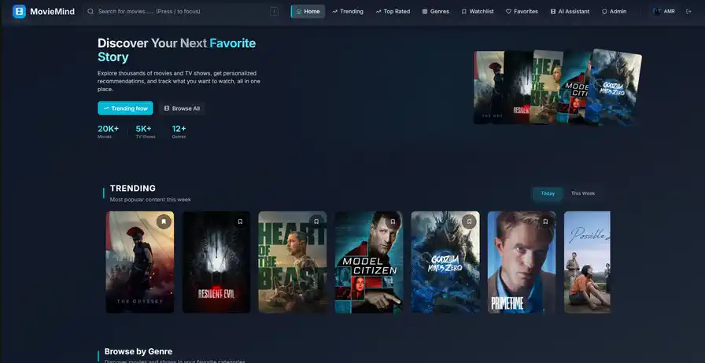
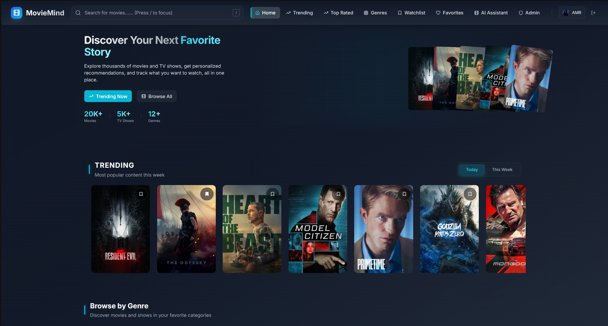
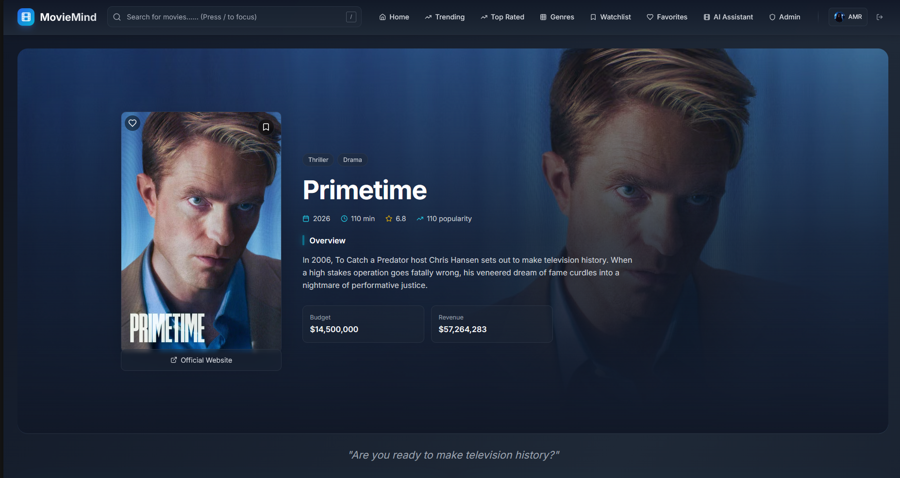
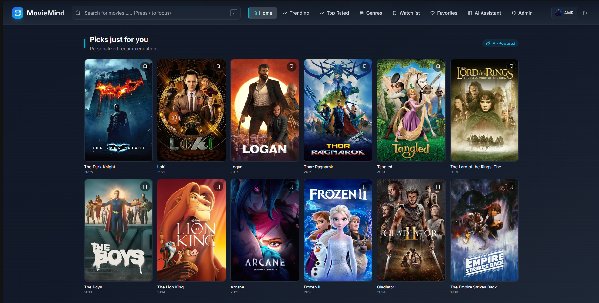
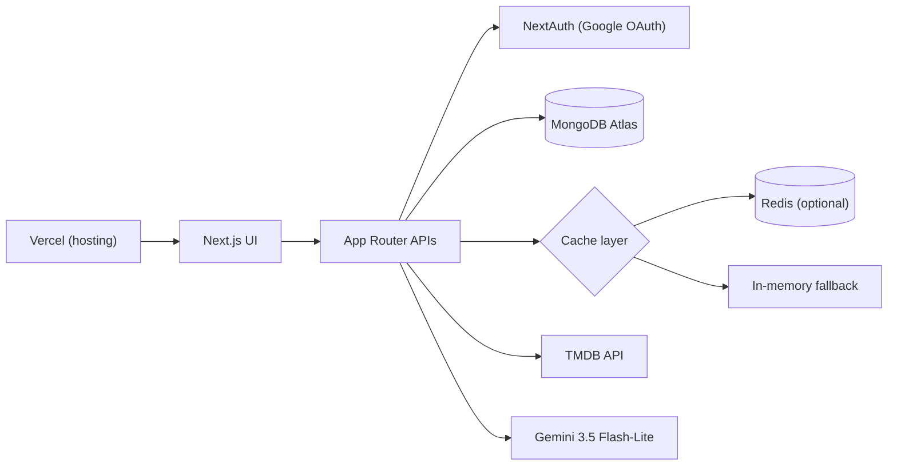

<div align="center">

# MovieMind

AI-powered movie discovery, personalized recommendations, and a secure personal watch experience.


**[Live Demo](https://moviemind-re.vercel.app/)**

[Demo](#product-demo) · [Features](#feature-highlights) · [Architecture](#architecture) · [Getting Started](#getting-started) · [Security](#security-and-privacy)



</div>

**Contents** · [Product Demo](#product-demo) · [Why MovieMind](#why-moviemind) · [Feature Highlights](#feature-highlights) · [Screenshots](#screenshots) · [Architecture](#architecture) · [Tech Stack](#tech-stack) · [Getting Started](#getting-started) · [Environment Configuration](#environment-configuration) · [Quality and Testing](#quality-and-testing) · [Security and Privacy](#security-and-privacy) · [Project Structure](#project-structure) · [Deployment](#deployment) · [Contributing](#contributing) · [Acknowledgements](#acknowledgements) · [License](#license)

## Product Demo

Sixty seconds of MovieMind in motion: discovery grids, the personalized "Picks just for you" row, the watchlist, a movie detail page with cast and trailer playback, the AI-powered similar-movies rail, and a celebrity page.

The recording above is an animated WebP optimized for this README — 896 x 462, 12 fps, infinite loop, approximately 7.5 MiB. For the interactive version, use the **[live demo](https://moviemind-re.vercel.app/)**.

## Why MovieMind

- **Everything in one place** — search, trending, top-rated, genres, and celebrity pages across movies and TV shows.
- **Personal, not just popular** — watchlist, favorites, viewing history (consent-based), mood- and time-based picks, and Gemini-powered recommendations that fall back to TMDB when AI is unavailable.
- **Private by design** — export your data, delete your account, control history tracking, and rely on bounded retention defaults.
- **Secure by default** — authentication, authorization, validation, and rate limiting are enforced server-side, never trusted to the browser.
- **Running in production** — deployed on Vercel with health endpoints for liveness and readiness.

## Feature Highlights

- **Google authentication** — NextAuth.js OAuth sign-in with server-side JWT sessions.
- **Discovery** — trending, top-rated, popular, and genre browsing for movies and TV; search across titles and people; trailers; celebrity pages.
- **AI recommendations** — personalized "Picks just for you" results from Gemini (model `gemini-3.5-flash-lite` by default, overridable with `GEMINI_MODEL`), runtime-validated with Zod and cross-checked against TMDB. If the model call fails, the route degrades to a TMDB popular fallback instead of failing the page.
- **AI similar movies** — per-title "AI-Powered" similar-movie suggestions, verified against TMDB.
- **AI chat assistant** — server-validated Gemini responses rendered as safe Markdown (no raw HTML).
- **Personal lists** — watchlist, favorites, viewing history with user consent, plus mood-based and time-based recommendations.
- **Privacy controls** — data export, account deletion with last-owner protection, history and chat deletion, history-tracking consent, and bounded retention.
- **Admin dashboard** — user management, namespace-scoped cache management, and system statistics for admin and owner roles.
- **Resilient caching** — Redis when configured, otherwise a bounded in-memory fallback; namespaced keys, SCAN-based cleanup, and stampede protection.
- **Rate limiting** — per-user limits on sensitive routes, with optional trusted-proxy CIDR support for correct client IPs behind a CDN.
- **Health endpoints** — `/api/health/live` for process liveness and `/api/health/ready` for configuration and MongoDB readiness.

AI features activate only when `GOOGLE_API_KEY` is set; the rest of the application works without it.

## Screenshots

### Home



### Movie details



### AI recommendations



## Architecture



- **Same-origin data access** — every read and write goes through App Router route handlers (`app/api/**`). TMDB and Gemini keys stay on the server; the browser never calls third-party APIs directly.
- **Authentication** — NextAuth (JWT strategy, Google provider) resolves identity. For privileged operations, roles are re-read from MongoDB rather than trusted from the session or request body.
- **Data** — MongoDB via Mongoose models; ownership of user data is keyed by the authenticated user's email.
- **Caching** — a namespaced cache layer over optional Redis (node-redis v4) with a bounded in-memory fallback when Redis is unavailable.
- **AI** — Gemini `generateContent` calls built with a separated system instruction, bounded context, and strict response schemas. Model output is treated as untrusted input.
- **Deployment** — hosted on Vercel (production: [moviemind-re.vercel.app](https://moviemind-re.vercel.app/)).

## Tech Stack

| Layer | Technology |
| --- | --- |
| Framework | Next.js 15 (App Router), React 18 |
| Language | TypeScript 5 |
| Authentication | NextAuth.js 4 (Google OAuth, JWT sessions) |
| Data | MongoDB with Mongoose 8 |
| Cache | Redis (node-redis 4), optional, with bounded in-memory fallback |
| Styling | Tailwind CSS 3.4, Radix UI primitives, lucide-react icons |
| Validation | Zod 4, React Hook Form |
| AI | Google Gemini REST API (default model `gemini-3.5-flash-lite`) |
| Metadata | TMDB API |
| Testing | Vitest 4, React Testing Library, jsdom |
| UI extras | recharts (admin charts), react-markdown (safe AI output) |

## Getting Started

### Prerequisites

- **Node.js 22** (the CI pipeline runs Node 22) and its bundled npm
- **MongoDB** — local instance or Atlas; required for authenticated features
- **TMDB API key** and **Google OAuth credentials** — required
- **Google Gemini API key** — only if you want the AI features
- **Redis** — optional; a bounded in-memory fallback is used when it is absent

### Setup

```bash
git clone https://github.com/amrhanyy/movie-recommendation-system.git
cd movie-recommendation-system
npm ci
cp .env.example .env.local
```

Fill in `.env.local` with your own values (never commit it — it is gitignored), then start the dev server:

```bash
npm run dev
```

Open [http://localhost:3000](http://localhost:3000).

Use `npm ci` for a reproducible install from the lockfile. `npm install` is only for intentional dependency work, not normal setup.

> **Warning:** `npm run setup-db` is a destructive operator script. Never run it as part of setup — see [Deployment](#deployment) for the full operational guidance.

## Environment Configuration

Copy `.env.example` to `.env.local` and fill in real values. Names only below — never commit values.

| Variable | Status | Purpose |
| --- | --- | --- |
| `NODE_ENV` | Optional | Runtime mode: `development`, `test`, or `production`. |
| `NEXTAUTH_URL` | Required in production | Canonical app origin. The production value must be an absolute HTTPS URL. |
| `NEXTAUTH_SECRET` | Required | JWT signing secret, minimum 32 characters (generate with `openssl rand -base64 32`). |
| `GOOGLE_CLIENT_ID` | Required | Google OAuth client identity. |
| `GOOGLE_CLIENT_SECRET` | Required | Google OAuth client secret. |
| `MONGODB_URI` | Required | MongoDB connection string (`mongodb://` or `mongodb+srv://`). |
| `TMDB_API_KEY` | Required | TMDB metadata access. |
| `GOOGLE_API_KEY` | Optional | Enables the AI features (chat, recommendations, similar movies). |
| `GEMINI_MODEL` | Optional | Overrides the Gemini model. **Defaults to `gemini-3.5-flash-lite`.** Read at call time; not listed in `.env.example`. |
| `TRUSTED_PROXY_CIDRS` | Optional | Comma-separated CIDRs of trusted reverse proxies or CDN edges so the rate limiter sees the real client IP. |
| `REDIS_URL` | Optional | Redis connection URL (`redis://` or `rediss://`; `rediss://` implies TLS). |
| `REDIS_HOST`, `REDIS_PORT`, `REDIS_USERNAME`, `REDIS_PASSWORD`, `REDIS_TLS` | Optional | Alternative to `REDIS_URL` when you configure Redis field by field. |
| `HISTORY_RETENTION_DAYS` | Optional | Viewing-history retention, bounded to 1-3650 days; invalid values fall back to the default. |
| `CHAT_RETENTION_DAYS` | Optional | Chat-history retention, bounded to 1-3650 days; invalid values fall back to the default. |

Notes:

- **Redis is optional.** Configure either `REDIS_URL` or `REDIS_HOST` + `REDIS_PORT` (plus optional username, password, TLS). Never combine a plain `redis://` URL with `REDIS_TLS=true` — the configuration is rejected.
- **AI features require `GOOGLE_API_KEY`.** Without it, AI routes stay unavailable and the application continues to work.
- **Production `NEXTAUTH_URL` must use HTTPS** — validation rejects anything else.
- Server secrets supplied under a `NEXT_PUBLIC_*` name are rejected by validation (`lib/env.ts`), so a misconfiguration fails loudly instead of leaking.
- Validation errors name variables and categories only, never values.

## Quality and Testing

Current suite: **49 test files, 615 tests, 0 failures.**

| Command | What it runs |
| --- | --- |
| `npm run lint` | ESLint across the project |
| `npm run typecheck` | TypeScript with `tsc --noEmit` |
| `npm test` | Vitest full suite |
| `npm run test:coverage` | Vitest with coverage reporting |
| `npm run build` | Production build |
| `npm run verify` | lint, typecheck, tests, and build in sequence |

Tests mock external services (NextAuth sessions, MongoDB/Mongoose, Redis, and global fetch). **Passing tests do not prove live provider availability** — OAuth, MongoDB, Redis, Gemini, and TMDB compatibility still require staging verification (see `DEPLOYMENT_SECURITY_CHECKLIST.md`).

CI (`.github/workflows/ci.yml`) runs lint, typecheck, tests, coverage, build, the fail-closed dependency-audit policy gate, and gitleaks secret scanning on pull requests and pushes to `main`.

## Security and Privacy

- **Server-side authentication and authorization** through central helpers (`lib/security/auth.ts`); roles are re-read from the database, so no client-supplied role, email, or ID is trusted for privileged operations.
- **Zod request validation** on API inputs, with generic error responses that never expose upstream bodies, stack traces, or secrets.
- **Role re-validation** on every privileged handler rather than a one-time check at sign-in.
- **Rate limiting** per user on sensitive routes (`lib/security/rateLimit.ts`).
- **Scoped cache controls** — keys are namespaced per environment and scope; destructive Redis commands (`FLUSHDB`, `FLUSHALL`, `KEYS`) are never used.
- **Fail-closed audit policy** — `scripts/audit-policy.mjs` requires both the production and bare dependency audits to be clean; any finding fails the gate with no silent exceptions.
- **Sanitized logging** — MongoDB connection failures log only an error name and numeric code, and Gemini provider logs pass metadata through a redaction layer.
- **Privacy controls** — authenticated export, confirmed account deletion with last-owner protection, consent-gated history tracking, and bounded retention.

These controls reduce risk; they are not absolute security guarantees. Prompt injection against the AI assistant remains a residual risk by design — model output is treated as untrusted. Some controls require staging-browser verification before production.

See [SECURITY.md](SECURITY.md) for vulnerability reporting and secret rotation, [PRIVACY.md](PRIVACY.md) for the operator privacy reference, and the `/privacy` page for the user-facing policy.

<details>
<summary>Privacy endpoints and retention controls</summary>

| Endpoint | Behavior |
| --- | --- |
| `GET /api/user/export` | Exports the current user's data (`no-store`, generic filename). |
| `DELETE /api/user/account` | Typed confirmation; last-owner protection; does not touch the Google account. |
| `DELETE /api/history` | Deletes the current user's viewing history. |
| `DELETE /api/chat-history` | Deletes all of the current user's conversations. |
| `DELETE /api/chat-history/[id]` | Deletes one conversation; session-scoped ownership check. |

- The `historyTrackingEnabled` preference is enforced server-side, not only in the UI.
- Retention for viewing history and chat history is bounded (1-3650 days) and configurable; invalid values fall back to defaults.
- Deleted data may remain in backups until backup expiration.

</details>

## Project Structure

```
app/            App Router pages and API route handlers (app/api/**)
components/     UI components (home, admin, chat, privacy, media)
contexts/       React contexts
hooks/          Custom hooks
lib/            Server helpers: auth, cache, env validation, models, privacy, rate limiting
types/          Shared TypeScript types
utils/          Client-side utilities
config/         Project configuration
scripts/        Operator scripts (audit policy, owner promotion, advanced DB tooling)
public/         Static assets
tests/          Vitest suites
docs/           Reports, operational docs, and README assets
.github/        CI workflow
```

Root documents: [SECURITY.md](SECURITY.md), [PRIVACY.md](PRIVACY.md), `OPERATIONS.md`, and `DEPLOYMENT_SECURITY_CHECKLIST.md`.

## Deployment

- **Environment** — set every variable from `.env.example` in your secret store with real values; never commit them. Use an HTTPS `NEXTAUTH_URL`.
- **Database** — prefer a MongoDB replica set so account deletion can run transactionally; keep a verified backup before any migration.
- **Probes** — wire load balancer or platform health checks to `/api/health/live` (process liveness) and `/api/health/ready` (configuration validation plus a MongoDB connect probe with an 8-second budget). Redis absence never fails readiness.
- **Before production** — replace the security and privacy contact placeholders in `SECURITY.md`, `PRIVACY.md`, and the `/privacy` page, then complete staging verification (CSP browser checks, privacy flows, CI pipeline dry run) per `DEPLOYMENT_SECURITY_CHECKLIST.md`.
- **Operations** — `OPERATIONS.md` covers deployment, rollback, backup/restore, secret rotation, and monitoring foundations.

<details>
<summary>Owner provisioning</summary>

- The HTTP owner-promotion endpoint (`POST /api/admin/promote`) is disabled: it always returns 404 and never reveals whether an owner exists.
- Owners are created with the documented operator CLI, `scripts/promote-owner.js`, which requires an explicit target email and proof that no owner exists. Never run it automatically.
- The last owner can never self-delete their account.

</details>

<details>
<summary>Database administration and destructive-operation warnings</summary>

- **Do not run `npm run setup-db` as part of normal setup.** The underlying script (`scripts/setupDatabase.cts`) is destructive or potentially destructive, must never run automatically, and must never run against production.
- Local development does not require destructive collection drops: Mongoose creates collections on use, and unique indexes are declared in the schemas.
- Production indexes and TTL migrations are operator-controlled and documented in `DEPLOYMENT_SECURITY_CHECKLIST.md` and `PRIVACY.md`; a verified backup is required before any migration.
- A MongoDB replica set is recommended so account deletion can run transactionally.

</details>

<details>
<summary>Redis administration</summary>

- Keys are namespaced as `movie-recommendation-system:{environment}:{cacheVersion}:{scope}:{resource}`.
- Destructive commands (`FLUSHDB`, `FLUSHALL`, `KEYS`) are not used anywhere in the application.
- Configure either `REDIS_URL` or the individual `REDIS_HOST` / `REDIS_PORT` / `REDIS_USERNAME` / `REDIS_PASSWORD` / `REDIS_TLS` fields; `rediss://` implies TLS, and a plain `redis://` URL combined with `REDIS_TLS=true` is rejected.
- Redis is optional: when it is unavailable, a bounded in-memory fallback with SCAN-based cleanup and stampede protection keeps the application working.

</details>

## Contributing

No `CONTRIBUTING.md` is published yet; a lightweight workflow is enough:

1. Fork the repository and create a focused branch.
2. Install with `npm ci`.
3. Make your change and add or update tests alongside it.
4. Run `npm run verify` (lint, typecheck, tests, build) before opening a pull request.
5. Describe the change, the motivation, and the validation you ran.
6. Never commit secrets, `.env.local`, or real third-party keys.

## Acknowledgements

- [TMDB](https://www.themoviedb.org/) — movie and TV metadata. This product uses the TMDB API but is not endorsed or certified by TMDB.
- Google Gemini API — AI recommendations, similar movies, and chat.
- Next.js, React, Tailwind CSS, Radix UI, Mongoose, and Vitest — the open-source foundation.
- MongoDB and Vercel — data and hosting.

## License

No open-source license has been published yet.