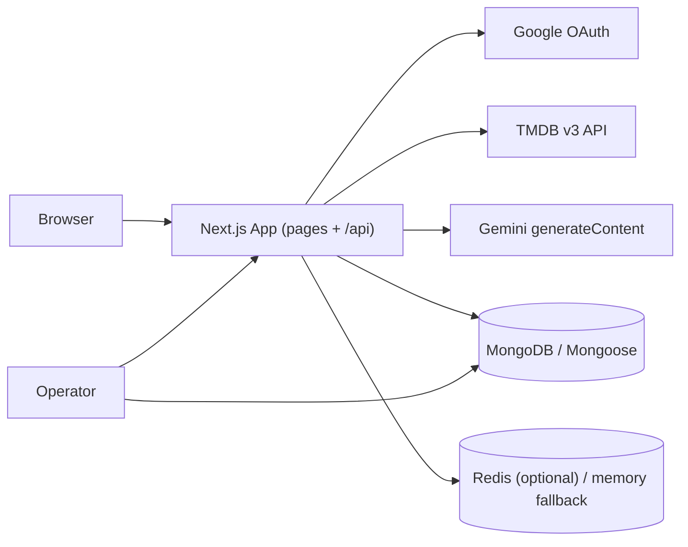
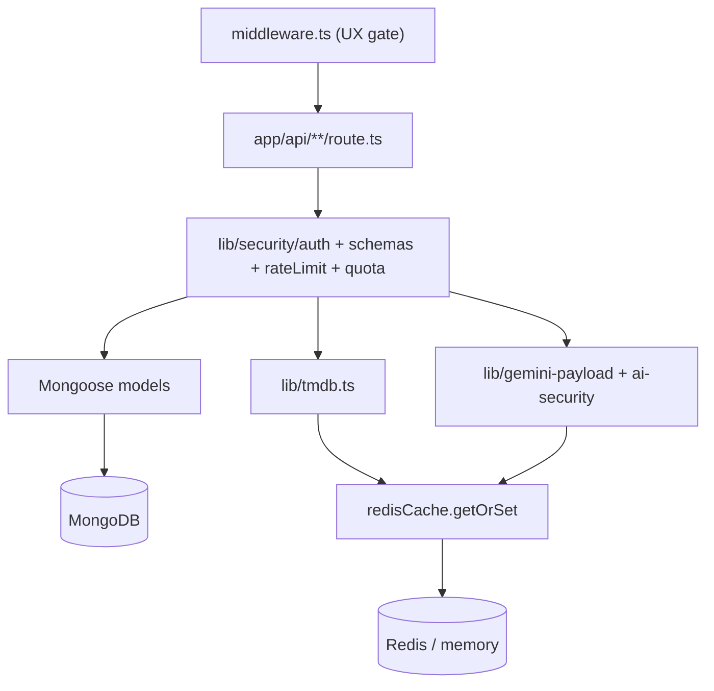
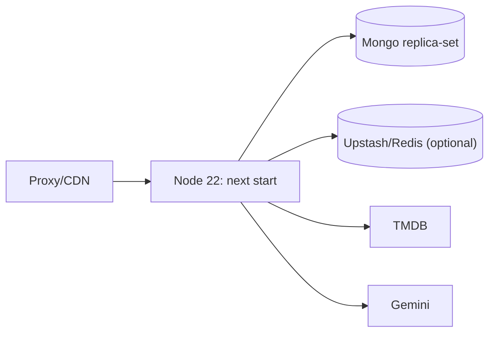
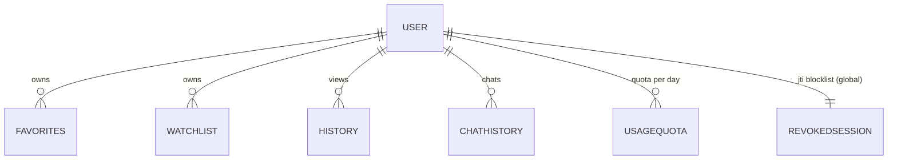
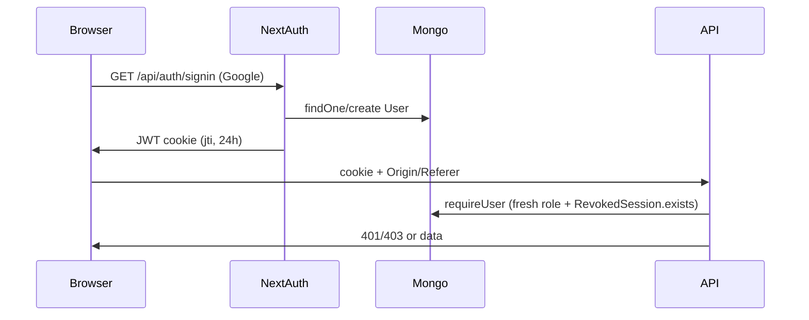

# Movie Recommendation System — Project Blueprint & Engineering Audit

## 1. Document control

- **Purpose:** Single authoritative technical blueprint + audit for developers / AI agents. Reconstructs product, architecture, data, interfaces, ops, risks from repo evidence.
- **Repo:** `movie-recommendation-system` (Next.js 15 App Router, single deployable). Root: `D:/fork ai to create website/final porject/movie-recommendation-system`.
- **Branch:** `main`. **SHA:** `70fe77655467f5105f5d0e9b02594ba1c62b2952`. Working tree deletes `docs/PROJECT_BLUEPRINT.md`, `docs/ARCHITECTURE_REVIEW.md`, `docs/SECURITY_AUDIT.md`, `docs/UI_UX_REVIEW.md` (git status, unstaged `D`); this file recreates the blueprint path only.
- **Date:** 2026-09-10 UTC.
- **Scope:** Full repo: `app/`, `components/`, `contexts/`, `hooks/`, `lib/`, `scripts/`, `tests/`, configs, CI, docs claims (sampled). Excludes `node_modules/`, `.next/`, `coverage/`.
- **Methodology:** Manifests/configs first, then auth/data/AI/cache paths, then representative routes + grep for `process.env`, handlers, tests. Validation: `npm run typecheck` (pass), `npm run lint` (pass, 94 warnings), `npm test` (349/349 pass). No build/deploy/migration run. No secrets printed.
- **Evidence classes:** Plain statements = Verified (cited). `Inferred:` = strong multi-signal suggestion. `Unknown:` = not determinable.
- **Limitations:** No live Mongo/Redis/TMDB/Gemini probed. `.env`/`.env.local` present on disk but not read (secret hygiene). Prior `docs/*.md` reports sampled, not re-verified line-by-line. Stale `PROJECT_ARCHITECTURE.md` claims ignored where contradicted by code.
- **Confidence:** High for auth, validation, cache, AI plumbing, routes, env schema, tests. Medium for perf hot-path costs (no prod profiling). Low for deployment topology (no IaC/Dockerfile in repo).

## 2. Table of contents

- [1. Document control](#1-document-control)
- [2. Table of contents](#2-table-of-contents)
- [3. Executive summary](#3-executive-summary)
- [4. Product and domain model](#4-product-and-domain-model)
- [5. Technology stack](#5-technology-stack)
- [6. System context](#6-system-context)
- [7. Architecture overview](#7-architecture-overview)
- [8. Repository map](#8-repository-map)
- [9. Application and package catalog](#9-application-and-package-catalog)
- [10. Data architecture](#10-data-architecture)
- [11. API and interface surface](#11-api-and-interface-surface)
- [12. Critical end-to-end flows](#12-critical-end-to-end-flows)
- [13. Authentication, authorization, and trust boundaries](#13-authentication-authorization-and-trust-boundaries)
- [14. External integrations](#14-external-integrations)
- [15. Configuration and environment variables](#15-configuration-and-environment-variables)
- [16. Local development guide](#16-local-development-guide)
- [17. Build, deployment, and operations](#17-build-deployment-and-operations)
- [18. Testing strategy and current test posture](#18-testing-strategy-and-current-test-posture)
- [19. Engineering findings](#19-engineering-findings)
- [20. Positive engineering observations](#20-positive-engineering-observations)
- [21. Risk register and prioritized remediation roadmap](#21-risk-register-and-prioritized-remediation-roadmap)
- [22. Validation and execution report](#22-validation-and-execution-report)
- [23. Coverage and omissions ledger](#23-coverage-and-omissions-ledger)
- [24. Glossary](#24-glossary)
- [25. Mental model for future developers and AI agents](#25-mental-model-for-future-developers-and-ai-agents)
- [26. New-developer reading order](#26-new-developer-reading-order)
- [27. Open questions](#27-open-questions)

## 3. Executive summary

MovieMind is a Google-OAuth, Next.js-fullstack movie/TV discovery app: public TMDB browsing (trending, search, genres, details, trailers, celebrities, mood/time-based) plus authenticated personalization (favorites, watchlist, history, AI chat, AI recommendations, AI-similar, admin console, privacy export/delete). Single Next.js deployable; MongoDB/Mongoose persistence keyed by user email; optional Redis with bounded in-memory fallback under one canonical namespace; Gemini `generateContent` via `x-goog-api-key` header with Zod-validated structured output.

Architectural shape: server-rendered App Router + 44 `app/api/**/route.ts` handlers; central server auth (`lib/security/auth.ts`), strict Zod schemas (`lib/security/schemas.ts`), per-user/IP rate limits (`lib/security/rateLimit.ts`), daily AI quotas (`lib/security/quota.ts`), cardinality trims, retention cutoffs, namespaced cache (`lib/cache*.ts`), hardened CSP/cookies.

Maturity: high security hygiene (origin gate, fail-closed features/auth, PII-safe logs), 36 test files / 349 tests passing, typecheck clean, lint 0 errors. Top strengths: authZ correctness, cache namespace discipline, AI output validation, privacy export/delete. Top risks: AI cost/fan-out paths (unbounded enrichment in ai-similar; quota consumed before input validation in chat), retention enforced only at read-time (no DB TTL), import-time Mongo throw, no containers/observability backend.

Next: fix quota-before-validation + ai-similar concurrency cap, enable operator TTL migration with backups, add Dockerfile/health wiring docs, clear lint warnings, add production error-monitoring.

## 4. Product and domain model

- **Purpose:** Discover movies/TV (TMDB proxy), track taste (favorites/watchlist/history), get Gemini-grounded recommendations/chat. Verified by `app/page.tsx:38-277`, `app/api/*`, `components/*`.
- **Users/roles:** Anonymous browsers (public TMDB reads); authenticated `user`; `admin`; `owner`. Role enum in `lib/auth.ts:10`, `lib/models/User.ts:20`. Admin-only console at `app/admin/page.tsx` + server guard `app/admin/layout.tsx:20-40`.
- **Core use cases:**
  1. Browse trending/search/genres/details/trailers — no login. Handlers `app/api/trending/route.ts:14`, `app/api/search/route.ts:9`, `app/api/genres/route.ts:11`, `app/api/movie/[id]/route.ts:13`.
  2. Save favorites/watchlist (500 cap, rollback) — `app/api/favorites/route.ts:37-148`, `app/api/watchlist/route.ts:37-151`.
  3. Passive history (consent-gated, 2000 cap, 20-read) — `app/api/history/route.ts:50-170`.
  4. AI chat (10/min + 50/day, 100 chats/user, 200 msgs/chat) — `app/api/chat/route.ts:132-255`.
  5. AI recommendations (5/min + 20/day, content-hash cache 3600s) — `app/api/ai-recommendations/route.ts:136-530`.
  6. AI-similar per movie (10/min, 24h cache) — `app/api/movie/[id]/ai-similar/route.ts:126-316`.
  7. Admin: users/stats/settings/cache — `app/api/admin/*/route.ts`.
  8. Privacy: export JSON, delete account, retention — `app/api/user/export/route.ts:33`, `app/api/user/account/route.ts:42`, `lib/privacy-service.ts:17-181`.
- **Entities:** `User`, `Favorites`, `Watchlist`, `History`, `ChatHistory`, `UsageQuota`, `RevokedSession`, `FeatureSettings` (inline schema in `app/api/features/route.ts:15-22` + `app/api/admin/settings/route.ts`).
- **Business rules (verified):** favorites/watchlist max 500 with post-write rollback (`app/api/favorites/route.ts:126-136`); history max 2000 (`app/api/history/route.ts:129`); chats max 100 (`app/api/chat/route.ts:237`); chat quota 50/day, recs 20/day (`app/api/chat/route.ts:154`, `app/api/ai-recommendations/route.ts:221`); export caps 500 history / 100 chats (`lib/privacy-service.ts:34-35`); last-owner cannot be demoted/deleted (`lib/security/auth.ts:326-350`, `app/api/admin/users/route.ts:168-175`, `lib/account-deletion.ts:35-68`); `previousMessages` client field ignored (`app/api/chat/route.ts:178`, `lib/security/schemas.ts:69-76`); history writes return `{success:false,reason:"tracking_disabled"}` when consent off (`app/api/history/route.ts:102-108`).
- **State transitions:** `user→admin→owner` only via owner CLI (`scripts/promote-owner.js:38-120`); `/api/admin/promote` always 404 (`app/api/admin/promote/route.ts:15-22`); JWT `jti` issued once, revoked on signOut (`lib/auth.ts:58-66`, `lib/auth.ts:199-250`); Redis health `healthy→disabled→cooldown-retry` (`lib/redis-health.ts:46-97`); readiness `ready/degraded/unavailable` (`app/api/health/ready/route.ts:65-138`).
- **Feature inventory:** `features.aiAssistant` boolean gates `/ai-assistant` + `/api/ai-recommendations` fail-closed (`middleware.ts:24-50`, `app/api/features/route.ts:52-64`). No other flags in code.

## 5. Technology stack

| Layer | Technology | Version/constraint | Purpose | Evidence | Confidence |
|---|---|---|---|---|---|
| Runtime/UI | Next.js App Router + React 18 | `next ^15.5.9`, `react ^18.3.1` | SSR pages + API routes | `package.json:56-59`, `app/layout.tsx:26-84` | High |
| Auth | next-auth v4 Google + JWT | `next-auth ^4.24.15`, maxAge 86400/updateAge 3600 | OAuth login, stateless session + DB role | `lib/auth.ts:40-56`, `package.json:57` | High |
| DB/ODM | MongoDB + Mongoose | `mongodb ^6.13.0`, `mongoose ^8.24.3` | Users, lists, history, chats, quotas | `lib/mongodb.ts:30-56`, `lib/models/*.ts` | High |
| Cache | node-redis + memory LRU fallback | `redis ^4.7.0`, 5000 entries, 1000 inflight | TMDB/AI cache, rate-limit counters | `lib/redis.ts:38-129`, `lib/cache.ts:10-28`, `package.json:66` | High |
| AI | Gemini generateContent REST | default `gemini-3.7-flash`, 15s timeout | Chat, recs, similar | `lib/gemini-payload.ts:8-20`, `lib/ai-security.ts:190-259` | High |
| Upstream media | TMDB v3 REST (api_key query) | `https://api.themoviedb.org/3`, 8s timeout/2 retries | All catalog data | `lib/tmdb.ts:6-69` | High |
| Validation | Zod strict schemas | `zod ^3.24.1` | Input + AI output | `lib/security/schemas.ts:1-161`, `lib/ai-security.ts:134-164` | High |
| Styling/UI | Tailwind + shadcn/Radix | `tailwindcss ^3.4.17` | Design system | `tailwind.config.ts`, `components/ui/` (43 files) | High |
| Tests | Vitest node+jsdom + RTL | `vitest ^3.2.7`, 36 files | Unit/contract/UI | `vitest.config.mts:12-49`, `tests/` | High |
| Lint/types | ESLint next + tsc strict | `eslint ^9.39.5`, `typescript ^5` | Quality gates | `eslint.config.mjs`, `tsconfig.json:11-14` | High |
| CI | GitHub Actions Node 22 | ci.yml validate/test/security/build | Gates | `.github/workflows/ci.yml:15-139` | High |
| Fonts/images | next/font Inter, next/image avif/webp | pinned TMDB/lh3 hosts | Perf | `app/layout.tsx:14`, `next.config.mjs:3-22` | High |

`Inferred:` Node 22 is the canonical runtime (CI pins 22; no `.nvmrc` found). No Docker/K8s/Terraform/Vercel config in repo — deployment target is operator-managed Node (see §17).

## 6. System context

Internal actors: anonymous visitor, authenticated user, admin, owner, operator (CLI + Mongo). External: Google OAuth, TMDB API, Gemini API, MongoDB Atlas/compatible, optional Redis/Upstash, reverse proxy/CDN (XFF source).

Trust boundaries: browser→Next.js (cookies, origin gate); Next.js→Mongo/Redis (connection strings); Next.js→TMDB/Gemini (server keys, never to client). CSP `connect-src 'self'`, `frame-src youtube-nocookie` only (`next.config.mjs:30-52`).



Explanation: all third-party secrets stay server-side; browser only talks same-origin (CSP + origin gate). Redis/Mongo failures degrade (memory fallback / 503 readiness), never leak secrets.

## 7. Architecture overview

- **Style:** Monolithic fullstack App Router; route-handler controllers → `lib/security/*` guards → Mongoose models / `tmdbClient` / Gemini fetch → `redisCache.getOrSet`. UI holds no business logic beyond optimistic contexts (`contexts/FavoritesContext.tsx`, `contexts/WatchlistContext.tsx`).
- **Deployable:** One Node service (`npm run build` + `npm start`). No workspaces/monorepo.
- **Components:** `app/**` pages/layouts; 44 API handlers; `lib/auth.ts` (NextAuth options); `lib/security/auth.ts` (require*/origin/owner guards); `lib/security/rateLimit.ts` + `quota.ts` + `cardinality.ts`; `lib/cache*.ts` + `redis*.ts`; `lib/tmdb.ts`; `lib/gemini-payload.ts` + `ai-security.ts`; `lib/privacy-*.ts` + `account-deletion.ts`; `middleware.ts` (UX defense-in-depth); `instrumentation.ts` (prod boot gate).
- **Comms:** Same-origin JSON over HTTPS; server→TMDB/Gemini HTTPS+JSON; server→Mongo via Mongoose; server→Redis via node-redis. No queues/sockets/cron in repo.
- **Dependency direction:** routes → lib/security → lib/models|tmdb|gemini → mongodb/redis. `lib/env.ts` standalone (never client-imported by convention).





- **Startup:** `instrumentation.ts:19-63` `register()` (nodejs+production only) calls `runtimeEnv()`; core errors throw (boot fails), Redis-only errors degrade to memory + warn. `lib/mongodb.ts:30-56` lazy global-cached connect; `lib/redis.ts:38-129` lazy connect with 60s block + health gate.
- **Failures:** readiness 503 degraded/unavailable (`app/api/health/ready/route.ts:100-138`); features 503 fail-closed (`app/api/features/route.ts:52-64`); middleware AI routes 503/redirect fail-closed (`middleware.ts:40-49`); JWT callback fail-closed on missing id (`lib/auth.ts:80-129`); quota/rate-limit 429 with Retry-After.

## 8. Repository map

Pruned tree (source/config only; omits `node_modules/.next/coverage`):

```text
app/ layout.tsx page.tsx error.tsx loading.tsx not-found.tsx globals.css
app/[mediaType]/[id]/ app/actor/[id]/ app/admin/ app/ai-assistant/ app/auth/signin/
app/celebrities/ app/favorites/ app/feature-unavailable/ app/genre/[id]/ app/genres/
app/movie/[id]/ app/privacy/ app/profile/ app/search/ app/top-rated/ app/trending/ app/tv/[id]/ app/watchlist/
app/api/ 44 route.ts (actor, admin/*, ai-recommendations, auth, celebrities, chat, chat-history*,
  favorites, features, genre*, genres, health/*, history, mood-recommendations, movie/*, movies*,
  search, trailers, trending*, tv/*, user*, users, watchlist*)
components/ 43 top-level + admin/4 + home/LatestTrailers + layout/ + ui/43 (shadcn)
contexts/ FavoritesContext WatchlistContext LanguageContext
hooks/ lib/ 21 + models/8 + security/6
scripts/ promote-owner.js setupDatabase.cts testRedisConnection.ts download-genre-images.js
tests/ 36 + helpers
middleware.ts instrumentation.ts next.config.mjs tailwind/postcss/eslint/vitest/tsconfig
.github/workflows/ci.yml .github/dependabot.yml .env.example
```

Per-directory: `app/api/*` = controllers (parse→guard→logic→respond); `lib/security/*` = cross-cutting guards; `lib/models/*` = Mongoose schemas; `lib/cache*`+`lib/redis*` = caching; `components/*` = client UI + optimistic contexts; `scripts/` = operator CLIs (one destructive); `tests/` = contract/security/perf tests; no generated-code dirs except `.next/`.

## 9. Application and package catalog

Single application `movie-recommendation-system@1.0.0` (`package.json:1-3`). No packages/workspaces.

| Item | Type | Entry | Build/test | Config | Deploy | Evidence |
|---|---|---|---|---|---|---|
| Next.js app + API | monolith | `app/layout.tsx:26`, `app/page.tsx:36`, `middleware.ts:8`, `instrumentation.ts:19` | `npm run build` / `npm test` / `npm run lint`+`typecheck` | `next.config.mjs`, `lib/env.ts` | Node 22 `npm start`, probes `/api/health/live`, `/api/health/ready` | `package.json:5-14` |
| Operator CLI promote-owner | script | `scripts/promote-owner.js:38` | manual `node scripts/promote-owner.js <email>` | `MONGODB_URI` | operator laptop/bastion | `scripts/promote-owner.js:1-28` |
| setupDatabase | destructive script | `scripts/setupDatabase.cts` | `npm run setup-db` — never prod | `MONGODB_URI`, `WIPE_PRODUCTION` | local only | `package.json:13`, script header |
| testRedisConnection | diagnostic | `scripts/testRedisConnection.ts` | `npm run test-redis` | Redis vars | local | `package.json:14` |

## 10. Data architecture

Stores: MongoDB (primary), Redis (cache + rate counters, optional), in-memory LRU (fallback), browser (NextAuth cookies only — no localStorage persistence found). No search/vector/queue/blob stores. No migrations dir; no seed except destructive setup script.

Schemas (all Mongoose, `_id` ObjectId PK):

- `User` (`lib/models/User.ts:5-28`): `email! unique`, `name?`, `image?`, `role enum user|admin|owner default user`, `preferences{favorite_genres[], selected_moods[], historyTrackingEnabled default true}`, `created_at`. Helper `getUserByEmail`.
- `Favorites` (`lib/models/FavoritesModel.ts:3-22`): `userId!`, `itemId!`, `type movie|tv`, `title!`, `posterPath?`, `createdAt`; unique `{userId,itemId,type}`.
- `Watchlist` (`lib/models/WatchlistModel.ts`, same shape, model `Watchlist`).
- `History` (`lib/models/History.ts:3-30`): `userId!`, `itemId!`, `type movie|tv|person`, `title!`, `posterPath?`, `viewedAt`; unique `{userId,itemId,type}` + `{userId,viewedAt:-1}` trim index. TTL commented out (operator migration).
- `ChatHistory` (`lib/models/ChatHistory.ts:3-32`): `userId!`, `messages[{role,title enum,content!,timestamp}]`, `createdAt/updatedAt`; `{userId,updatedAt:-1}` index. TTL commented out.
- `UsageQuota` (`lib/models/UsageQuota.ts:3-24`): `userId!`, `day YYYY-MM-DD!`, `chats/recs`, `expiresAt!`; unique `{userId,day}` + TTL `expiresAt`.
- `RevokedSession` (`lib/models/RevokedSession.ts:3-15`): `jti! unique`, `expiresAt!` + TTL.
- `FeatureSettings` inline (`app/api/features/route.ts:15-22`): `features.aiAssistant default true`, timestamps.

Relations: all user-owned rows keyed by `userId = session email` (not ObjectId) — `Inferred:` legacy choice simplifies session scoping but couples rename/email-change. Cardinality: 1 user → N list/history/chat rows, bounded by trims (500/2000/100/200-per-chat).

Transactions: non-atomic per-route writes except atomic quota `findOneAndUpdate upsert` (`lib/security/quota.ts:44-56`) and atomic list-cap rollback (`app/api/favorites/route.ts:126-136`). Account deletion is staged "All Writes" (collections→cache noop→user last), retry-safe, partial-failure reported (`lib/privacy-service.ts:155-181`), replica-set `withTransaction` optional per docs.

Caches: namespace `movie-recommendation-system:{production|development}:v1:` (`lib/cache-namespace.ts:19-28`); scopes `public:tmdb`, `user:recommendations`, `security:rate-limit`, `admin:cache-metadata`, `public:ai-similar` (`lib/cache-namespace.ts:27-34`); TTLs: search 300s, movie details 1800s, recs 3600s, ai-similar 86400s, TMDB fetch revalidate 3600s. Invalidation: admin-scoped + per-movie/TV/home (`lib/cacheManager.ts:22-57`); never FLUSHDB/KEYS (SCAN only).

Retention/deletion: `HISTORY 180d / CHAT 365d` defaults, bounds 1..3650 (`lib/privacy-retention.ts:11-16`); enforced at query time (`updatedAt/viewedAt $gte cutoff`) in history/chat/export routes — **not** by DB TTL (see DATA-001). PII: email/userId/title/message are PII — never logged (operational-log blocklist `lib/operational-log.ts:25-39`, redact helpers). Encryption at rest/in transit: `Unknown:` no repo evidence beyond `mongodb+srv`/https URLs.



## 11. API and interface surface

Conventions: `requireUser` (fresh DB role + revocation) for personal/AI/admin; `requireAdmin/requireOwner` for admin; `applyRateLimitUser/Public` everywhere except `/api/features`, health, promote/users stubs; `assertSameOriginOrReject` on cookie-authed mutations; strict Zod bodies; generic 500s; 401 unauthenticated / 403 unauthorized-or-missing-chat / 404 user-not-found / 429 quota/rate.

Public TMDB proxy (IP rate-limited, cached `public:tmdb`): `GET /api/trending`, `/api/trending/movie`, `/api/trending/tv` (latter two uncached — see PERF-002), `/api/movies`, `/api/movies/time-based` (optional `tryRequireUser` personalization), `/api/movies/top-rated`, `/api/tv/top-rated`, `/api/genres` (strict 10/min, ~20 fan-out), `/api/genre/[id]`, `/api/genre/[id]/content`, `/api/movie/[id]`, `/api/movie/[id]/recommendations`, `/api/movie/[id]/similar`, `/api/tv/[id]`, `/api/tv/[id]/recommendations`, `/api/tv/[id]/similar`, `/api/actor/[id]`, `/api/celebrities`, `/api/search` (30/min, 200-char cap), `/api/mood-recommendations`, `/api/trailers` (strict 10/min).

Authenticated personal: `GET|POST|DELETE /api/favorites`, `/api/watchlist` (500 cap); `GET /api/watchlist/details` (50-item cap, pool 8, 1800s); `GET|POST|DELETE /api/history` (person allowed, consent-gated); `GET /api/user` + `PUT /api/user` (preferences only); `GET /api/user/export` (5/5min); `DELETE /api/user/account` (2/5min, `DELETE_MY_ACCOUNT` literal); `GET|POST|DELETE /api/chat-history`, `GET /api/chat-history/list` (100 cap), `GET|DELETE /api/chat-history/[id]`; `POST /api/chat` (chat quota); `GET /api/ai-recommendations` (recs quota, hash-cache); `GET /api/movie/[id]/ai-similar` (per-user limit, 24h cache); `POST /api/users` always 403 disabled; `POST|GET /api/admin/promote` always 404.

Admin (`requireAdmin`): `GET|PUT /api/admin/users` (ObjectId zod, last-owner + self-demotion guards), `GET /api/admin/stats` (counts + cache stats + growth), `GET|POST /api/admin/settings` (`{config:{features:{aiAssistant}}}` strict), `GET|POST|DELETE /api/admin/cache` (invalidate/clear, 1000-key cap).

System: `GET /api/health/live` (sync, no deps); `GET /api/health/ready` (config gate + 2s mongo ping, redis optional label); `GET /api/features` (public, 503 fail-closed); `GET|POST /api/auth/[...nextauth]` (IP 30/min wrapper).

No GraphQL/RPC/WS/SSE/queues/cron/deep-links/MCP in repo.

## 12. Critical end-to-end flows

### F1 — Google sign-in → JWT → session (Verified)

Trigger: `GET /auth/signin` → Google OAuth. Entry: `app/api/auth/[...nextauth]/route.ts:28-32` → `authOptions` (`lib/auth.ts:40-56`). `signIn` creates `User{role:user}` or fails closed (`lib/auth.ts:130-164`). `jwt` assigns `randomUUID jti` once, projects fresh DB role/preferences, fail-closed on missing id (`lib/auth.ts:58-129`). `session` projects from JWT only (no DB hot path) (`lib/auth.ts:165-195`). `signOut` upserts `RevokedSession{jti,expiresAt}` with TTL (`lib/auth.ts:199-250`). Tests: `tests/session-lifecycle.test.ts`, `tests/signin-log-hygiene.test.ts`.



### F2 — Public trending browse (Verified)

`app/page.tsx:43-58` `fetch('/api/trending')` → `app/api/trending/route.ts:14` `applyRateLimitPublic(tmdbProxy)` → `redisCache.getOrSet(public:tmdb…)` → TMDB `fetchJsonWithRetry` (8s/2 retries, revalidate 3600) → JSON. No auth/origin. Failure: hero error + retry (`app/page.tsx:217-228`).

### F3 — Favorites toggle with cap+rollback (Verified)

`FavoriteButton` → `FavoritesContext` optimistic POST → `app/api/favorites/route.ts:37-148`: `requireUser` → origin → `listItemSchema.strict()` → `listWrite` 20/min → `countDocuments` + `exists` pre-check → `findOneAndUpdate upsert new:true` → post-write count → overshoot `deleteOne(res._id)` 400. `DELETE` uses query `itemId+type` strict movie|tv. Tests: `tests/favorites-context.test.tsx`, `tests/list-capacity-security.test.ts`.

### F4 — AI chat (Verified)

`ChatAssistant` POST `{message,chatId?}` → `app/api/chat/route.ts:132`: `requireUser` (revocation-checked) → origin → per-user `chat:10/min` → `consumeQuota(chats,50)` → `chatRequestSchema` (ignores `previousMessages`) → load `ChatHistory{chatId,userId}` or 403 → `boundChatHistory` (20 msgs/8000 chars) → `buildChatGeminiPayload` + `x-goog-api-key` POST 15s, 1 retry on UNAVAILABLE → `$push $slice:-200` or `create` → `trimCollection(100)` → `{response,chatId}`. AI errors mapped to 429/502/503/504 (`lib/ai-security.ts:236-259`). Tests: `tests/chat-trust-boundary.test.ts`, `tests/quota-security.test.ts`.

### F5 — AI recommendations (Verified)

`ForYouSection` GET → `app/api/ai-recommendations/route.ts:136`: `requireUser` → 5/min → load history(200)/watchlist(500)/favorites(500) → empty-lists early `{needsContent:true}` → sha16 content-hash key → `redisCache.get` hit returns → else `consumeQuota(recs,20)` → Gemini `buildRecommendationGeminiPayload` (3× backoff) → Zod `aiRecommendationsSchema` (≤12) → TMDB `search/multi` enrichment pool 4 → dedupe/balance → `redisCache.set 3600s`. Fallbacks: popular movies/TV on AI failure. Notable: `item.id` vs model `itemId` mismatch (REL-003).

### F6 — Admin user update (Verified)

`UserManagement.tsx` PUT → `app/api/admin/users/route.ts:74`: `requireAdmin` → origin → `adminMutation` 30/min → `adminUpdateSchema` (ObjectId) → self-demotion/owner-only/admin-scope/last-owner checks → allowlisted `$set` only. Tests: `tests/redis-cache-security.test.ts` (R4-E matrix).

### F7 — Privacy export/delete (Verified)

Export `app/api/user/export/route.ts:33`: `requireUser` → `userExport` 5/5min → parallel projected finds (cutoffs applied, 500/100 caps) → `buildExportObject` → `attachment movie-data-export.json`, `no-store`. Delete `app/api/user/account/route.ts:42`: `requireUser` → `accountDelete` 2/5min → origin → `confirmation:DELETE_MY_ACCOUNT` strict → `mayDeleteOwnAccount` fresh role → staged `deleteAccountAllWrites`. Tests: `tests/privacy-account-security.test.ts`.

## 13. Authentication, authorization, and trust boundaries

- **IdP/login:** Google OAuth only (`lib/auth.ts:41-46`). Custom signin page `app/auth/signin/page.tsx`. No passwords/credentials provider. `NEXTAUTH_SECRET` ≥32 chars enforced non-test (`lib/env.ts:157-164`); prod `NEXTAUTH_URL` https (`lib/env.ts:168-176`).
- **Session/token:** JWT strategy 24h sliding (`maxAge 86400/updateAge 3600`, `lib/auth.ts:47-53`); `jti randomUUID` per token; secure `__Secure/__Host` cookie names + `httpOnly/lax/secure(path /)` in prod (`lib/auth.ts:257-295`); server revocation via `RevokedSession` TTL checked in `requireUser` (`lib/security/auth.ts:95-110`); `tryRequireUser` skips revocation check (optional-personalization path — see SEC-004).
- **Authorization:** `requireSession` (401) → `requireUser` (fresh DB role, 401/500) → `requireAdmin` (admin|owner, 403) / `requireOwner` (owner, 403) (`lib/security/auth.ts:50-239`). Route-level enforcement universal for personal/AI/admin; middleware is UX defense-in-depth only (`middleware.ts:52-79`). Admin page server guard redirects (`app/admin/layout.tsx:20-40`).
- **Trust transitions:** client `previousMessages`/ids/emails/roles never trusted (server re-read); chat-history id ownership checked `{_id,userId}` (`app/api/chat/route.ts:184-195`); export/delete identity from session only; admin `userId` must be ObjectId (CastError→400, `lib/security/schemas.ts:24-27`).
- **CSRF/origin:** `assertSameOriginOrReject` requires Origin→Referer→Sec-Fetch-Site, else 403, on all cookie-authed mutations (`lib/security/auth.ts:241-311`). No CORS config (same-origin only, CSP `connect-src 'self'`).
- **Gaps:** `tryRequireUser` bypasses revocation (SEC-004, low); middleware JWT check is presentation-layer (documented, not a gap); no server-side session absolute-timeout beyond JWT maxAge.

## 14. External integrations

| Provider | Purpose/caller | Config/auth | Data/timeout/retry | Errors/tests/risks |
|---|---|---|---|---|
| Google OAuth | login `lib/auth.ts:41-46` | `GOOGLE_CLIENT_ID/SECRET` | code exchange by next-auth | fail-closed signin false; tests mock; risk: misconfigured redirect URIs (Unknown: no prod URL) |
| TMDB v3 | catalog `lib/tmdb.ts:6-170` + ~25 routes | `TMDB_API_KEY` query param server-side | details/lists/search; 8s/2 retries, revalidate 3600 | generic 500s, no key leak (redacted logs `lib/fetchWithRetry.ts:14-24`); risk: quota theft via open proxy mitigated by rate limits; fan-out cost in genres/ai-similar |
| Gemini generateContent | chat/recs/similar `lib/gemini-payload.ts`, routes | `GOOGLE_API_KEY` header `x-goog-api-key`, model `GEMINI_MODEL` default `gemini-3.7-flash` | prompts bounded (8000 ctx, 500 overview, 8000 prefs); 15s timeout | mapped codes, redacted bodies, Zod output; residual prompt-injection documented in system prompts; cost risk without per-day quotas (mitigated) |
| MongoDB | all persistence `lib/mongodb.ts` | `MONGODB_URI` mongodb:// or srv | buffered off, global cached | readiness ping 2s; risk: standalone (no txn) partial delete (documented) |
| Redis/Upstash | cache + rate counters `lib/redis.ts`, `lib/redis-config.ts` | `REDIS_URL` or HOST/PORT/USER/PASS/TLS, 3s connect, queue 500, offline-queue off | namespaced keys, INCR+pExpire | memory fallback; max-clients 5-strike disable + 5min cooldown; risk: shared-instance pressure (calibrated) |

No email/SMS/analytics/error-monitoring provider integrated (`lib/operational-log.ts:98-107` stdout JSON only).

## 15. Configuration and environment variables

Catalog (names only, no values; `lib/env.ts:52-77` shape, `.env.example:1-53`):

| Name | Required | Purpose/consumers | Format/default | Sensitive |
|---|---|---|---|---|
| `NODE_ENV` | no | env switch, namespace prod/dev, cookie names | `development\|test\|production` | no |
| `NEXTAUTH_URL` | prod yes | origin gate expected origin, OAuth callback | https URL prod | no |
| `NEXTAUTH_SECRET` | yes (non-test) | JWT signing `lib/auth.ts:56` | ≥32 chars | **yes** |
| `GOOGLE_CLIENT_ID/SECRET` | yes (non-test) | OAuth provider | opaque | **yes (secret)** |
| `MONGODB_URI` | yes (non-test) | `lib/mongodb.ts:3` | `mongodb://` or `mongodb+srv://` | **yes** |
| `TMDB_API_KEY` | yes (non-test) | `lib/tmdb.ts:6` + ~25 routes | opaque | **yes** |
| `GOOGLE_API_KEY` | AI-only | `getGeminiApiKey()` | opaque; `aiFeaturesConfigured()` gate | **yes** |
| `GEMINI_MODEL` | no | `getGeminiModel()` | default `gemini-3.7-flash` | no |
| `REDIS_URL` / `REDIS_HOST/PORT/USERNAME/PASSWORD/TLS` | no | `buildRedisConfig()` | redis:// or rediss:// (TLS implied); contradictory redis://+TLS=true rejected | **yes (password/URL)** |
| `TRUSTED_PROXY_CIDRS` | no | XFF walk `lib/security/rateLimit.ts:139-156` | CSV CIDR/IP; /0 rejected | no |
| `HISTORY_RETENTION_DAYS` | no | `buildRetentionConfig()` | int 1..3650, default 180 | no |
| `CHAT_RETENTION_DAYS` | no | same | default 365 | no |
| `NEXT_RUNTIME` | runtime | instrumentation guard | `nodejs` | no |
| `WIPE_PRODUCTION` | script | `scripts/setupDatabase.cts` guard | never set prod | n/a |

`NEXT_PUBLIC_*` secrets rejected (`lib/env.ts:35-50`). Errors expose names/categories only (`lib/env.ts:108-235`).

## 16. Local development guide

Verified from `package.json:5-14`, `.env.example:1-53`, `instrumentation.ts:19-29`, `scripts/*`:

1. **Prereqs:** Node 22 (CI `uses setup-node v4 node-version 22`), npm, MongoDB (local or Atlas), optional Redis. No Docker in repo.
2. **Install:** `npm ci` (frozen lockfile; CI `ci.yml:30-31`).
3. **Env:** copy `.env.example` → `.env.local`; fill `MONGODB_URI`, `NEXTAUTH_SECRET` (≥32 chars, `openssl rand -base64 32`), `GOOGLE_CLIENT_ID/SECRET` (Google Cloud console), `TMDB_API_KEY` (themoviedb.org), `GOOGLE_API_KEY` (AI features), `NEXTAUTH_URL=http://localhost:3000` dev. Redis optional: leave unset for memory fallback, or set `REDIS_URL` / `REDIS_HOST+PORT`.
4. **DB:** no migrations. Optional destructive seed `npm run setup-db` — local only, never prod (script refuses production without explicit wipe flag).
5. **Run:** `npm run dev` (dev, instrumentation skipped non-prod) → http://localhost:3000. Prod-like: `npm run build` + `npm start` (requires prod env incl. https `NEXTAUTH_URL`).
6. **Test/lint:** `npm test` (vitest), `npm run lint`, `npm run typecheck`, `npm run verify` (all + build).
7. **Diagnostics:** `npm run test-redis`; probes `GET /api/health/live` (process) and `/api/health/ready` (config+DB).
8. **Troubleshoot:** boot throw = core env missing (read message names); Redis warn = memory fallback active; 503 features = DB down (fail-closed); 403 mutations = missing Origin/Referer (send same-origin headers); AI 502 = bad key/model, 503 = upstream down, 429 = quota.

## 17. Build, deployment, and operations

- **Build:** `next build` with `webpackBuildWorker` + parallel traces/compiles (`next.config.mjs:99-103`); images remote-pinned; CSP/security headers global (`next.config.mjs:24-98`). CI builds with placeholder env (`ci.yml:129-139`). Local `npm run build` needs real env or placeholders.
- **CI/CD:** `.github/workflows/ci.yml` four jobs (validate lint+typecheck; test+coverage artifact; `npm audit --audit-level=high --omit=dev` + gitleaks v8.18.4 full-history; build). `contents:read`, cancel-in-progress. Dependabot weekly npm+actions (`.github/dependabot.yml`). No CD/release workflow, no artifact registry, no rollback automation in repo.
- **Deployment:** `Unknown:` no Dockerfile/Compose/Vercel/IaC in repo (verified absent via glob). `Inferred:` platform-agnostic Node 22 (`next start`) behind proxy/CDN + managed Mongo + Upstash Redis, per `docs/ADR-001*` claims — not verified by IaC. Probes: liveness `/api/health/live`, readiness `/api/health/ready` (503 keeps traffic away when degraded).
- **Migrations/rollback:** none (schemaless Mongoose, additive indexes). TTL retention is a documented **operator** migration with backups, not code (`lib/models/History.ts:26-31`, `lib/models/ChatHistory.ts:27-32`).
- **Observability:** structured `ops {...}` JSON lines with PII blocklist (`lib/operational-log.ts:70-107`); no APM/Sentry/Datadog integration; health endpoints `no-store` + `nosniff`. Logs intentionally terse (no emails/URLs/keys).
- **Backups/scaling:** no repo evidence (Unknown: operator-owned Mongo backups, Redis eviction policy). Stateless app + shared Redis + `getOrSet` stampede dedupe (`lib/cache.ts:313-359`) support horizontal scale; `Inferred:` JWT stateless + memory fallback per-instance means rate/cache diverge across replicas without shared Redis.
- **Secrets:** store in platform secret manager, never `.env` commits (`.gitignore:19-24` ignores all variants); CI secret-scan enforced.

## 18. Testing strategy and current test posture

- **Types/locations:** 36 files in `tests/` (`*.test.ts` node project, `*.test.tsx` jsdom project, `vitest.config.mts:12-49`); coverage scope `app/api/**`, `lib/security/**`, `lib/ai-security.ts`, `lib/ai-markdown.tsx`, `lib/gemini-payload.ts`, `SafeYouTubeEmbed/Link` (`vitest.config.mts:35-47`).
- **Commands:** `npm test` (run), `npm run test:watch`, `npm run test:coverage` (v8 text+html). CI runs test + coverage + artifact upload (`ci.yml:55-68`).
- **Covered (verified by passing suite):** auth revocation/lifecycle, stale identity, origin gate, strict zod, rate-limit IP/coverage, quota, cache key normalization/personalization/queue calibration, chat trust boundary, AI browser/markdown XSS, features fail-closed, boot env/fatality, privacy export/delete/retention, admin matrix, edge imports, docs contract, favorites/watchlist contexts + N+1, a11y (M5), UI flows/consistency, perf M4 timeouts/caps.
- **Not covered:** live TMDB/Gemini contract (mocked), multi-replica Redis divergence, replica-set transaction path, production boot with real secrets, E2E (no Playwright/Cypress in repo), load/chaos.
- **Coverage %:** Unknown — no committed coverage artifact; local `test:coverage` not run in this audit (suite 349/349 passed, see §22).
- **Reliability:** M4 timeout tests take ~15s each by design (34s file); no flaky indicators observed in single run.

## 19. Engineering findings

Summary matrix:

| ID | Title | Sev / Conf / Status |
|---|---|---|
| REL-001 | Quota consumed before input validation (chat) | Medium / High / Confirmed |
| PERF-001 | ai-similar enrichment unbounded `Promise.all` | Medium / High / Confirmed |
| REL-002 | `lib/mongodb.ts` throws at import time | Medium / High / Confirmed |
| DATA-001 | Retention read-filter only, no DB TTL | Medium / High / Confirmed |
| REL-003 | Recs exclusion reads non-model `tmdbId` field | Medium / Medium / Probable |
| PERF-002 | Uncached trending/movie+tv + heavy genres fan-out | Low / High / Confirmed |
| SEC-004 | `tryRequireUser` skips revocation check | Low / High / Confirmed |
| QUAL-001 | 94 lint warnings (dead imports/vars) | Low / High / Confirmed |
| OPS-001 | No container/IaC/CD/rollback in repo | Info / High / Confirmed |
| TEST-001 | No E2E / live-contract / coverage artifact | Info / High / Confirmed |

### REL-001 — Quota consumed before input validation burns daily budget on bad input

- **Category:** Correctness. **Severity:** Medium. **Confidence:** High. **Status:** Confirmed. **Evidence:** Verified.
- **Location:** `app/api/chat/route.ts:154-176` (`consumeQuota` L154 before `request.json`/zod L162-176).
- **Observed:** Invalid JSON/body still increments `UsageQuota.chats`. Same ordering in recs is safe (quota after cache-hit check) but chat is not.
- **Why:** Attacker or buggy client can exhaust victim's own 50/day with malformed posts; legitimate typos cost quota.
- **Trigger:** POST `/api/chat` with malformed JSON or overlong message while authenticated.
- **Fix:** Parse + `chatRequestSchema.safeParse` first; consume quota only on valid input (after `chatId` ownership check or just before Gemini call). Keep rate-limit first.
- **Validate:** unit test POST invalid body ×3 → quota doc unchanged, 400s returned.
- **Effort:** S.

### PERF-001 — ai-similar TMDB enrichment fans out unbounded in one `Promise.all`

- **Category:** Performance. **Severity:** Medium. **Confidence:** High. **Status:** Confirmed. **Evidence:** Verified.
- **Location:** `app/api/movie/[id]/ai-similar/route.ts:257-308` (`await Promise.all(aiSuggestions.map(...search/movie...))`, up to 12 parallel TMDB searches).
- **Observed:** Cold path can fire 1 details + 1 Gemini + fallbacks + N searches concurrently; no pool (unlike recs pool-4 `app/api/ai-recommendations/route.ts:330-379` and watchlist pool-8 `app/api/watchlist/details/route.ts:20-49`).
- **Why:** Latency tail, TMDB 429s, serverless connection pressure; retries amplify.
- **Trigger:** cache-miss GET `/api/movie/[id]/ai-similar` returning ~12 suggestions.
- **Fix:** batch with pool 4 (copy recs pattern), cache negative/partial results briefly, cap enrichment to 8.
- **Validate:** mocked-TMDB concurrency counter test asserting max-inflight ≤4.
- **Effort:** S.

### REL-002 — Missing `MONGODB_URI` throws at module import, crashing any importer

- **Category:** Reliability. **Severity:** Medium. **Confidence:** High. **Status:** Confirmed. **Evidence:** Verified.
- **Location:** `lib/mongodb.ts:3-7` top-level `if (!MONGODB_URI) throw`.
- **Observed:** Importing the module (tests, health, build) crashes instead of failing at connect time with a named error; works around via `isCoreConfigReady`/placeholders in CI.
- **Why:** Fragile startup, harder to return 503 readiness; test setup must stub env before import.
- **Fix:** defer throw to `connectToMongoDB()`; export `isMongoConfigured()` for readiness.
- **Validate:** import without env succeeds; connect rejects with named error; readiness 503.
- **Effort:** S.

### DATA-001 — Retention is query-time filtering; expired rows remain in Mongo

- **Category:** Data integrity. **Severity:** Medium. **Confidence:** High. **Status:** Confirmed. **Evidence:** Verified.
- **Location:** `lib/models/History.ts:26-31`, `lib/models/ChatHistory.ts:27-32` (TTL commented, operator migration), reads filter `$gte cutoff` (`app/api/history/route.ts:60-64`, `app/api/chat-history/list/route.ts`, `app/api/user/export/route.ts:71-88`).
- **Observed:** `HISTORY_RETENTION_DAYS/CHAT_RETENTION_DAYS` hide but do not delete; DB grows unbounded (mitigated partially by 2000/100 trims); privacy "retention" overstates deletion.
- **Why:** Storage cost + GDPR-style deletion expectation gap.
- **Fix:** execute documented TTL operator migration with backup + pre-checks; or scheduled purge job; update privacy copy to "hidden after N days, purged by operator job".
- **Validate:** insert expired docs → after migration/purge they vanish; export excludes them.
- **Effort:** M (operator) / S (docs fix).

### REL-003 — Recommendations exclusion reads `w.tmdbId`/`f.tmdbId` but models store `itemId`

- **Category:** Correctness. **Severity:** Medium. **Confidence:** Medium. **Status:** Probable. **Evidence:** Inferred (needs runtime confirmation).
- **Location:** `app/api/ai-recommendations/route.ts:181-183` (`{title, type, id: w.tmdbId}`) vs `lib/models/FavoritesModel.ts:3-22` / `WatchlistModel` (`itemId`, no `tmdbId`).
- **Observed:** `item.id` always undefined → `item.id === match.id` never true; title-similarity still filters, ID check dead. Docs mention legacy-doc fallback elsewhere (`app/api/movies/time-based/route.ts:41-49`) but recs route has none.
- **Why:** Users may be recommended titles they own when title normalization misses (remakes, punctuation).
- **Fix:** read `itemId` (with `tmdbId` fallback), include in `sortedItems`/hash.
- **Validate:** seed favorite, mock Gemini echoing owned title + TMDB match → filtered out.
- **Effort:** S.

### PERF-002 — Two trending shards uncached; genres fans out ~20 upstream calls

- **Category:** Performance. **Severity:** Low. **Confidence:** High. **Status:** Confirmed. **Evidence:** Verified.
- **Location:** `app/api/trending/movie/route.ts:4`, `app/api/trending/tv/route.ts:4` (direct TMDB, no `getOrSet`); `app/api/genres/route.ts:11` fan-out.
- **Observed:** Every page load hits origin for shards; genres mitigated by `tmdbProxyStrict` 10/min but still heavy per call.
- **Why:** Avoidable origin load/latency; inconsistent with cached `/api/trending`.
- **Fix:** wrap shards in `getOrSet` 300s like siblings; keep strict limit on genres.
- **Validate:** double-GET test asserts single upstream fetch.
- **Effort:** S.

### SEC-004 — Optional-auth path skips JWT revocation check

- **Category:** Security. **Severity:** Low. **Confidence:** High. **Status:** Confirmed. **Evidence:** Verified.
- **Location:** `lib/security/auth.ts:160-192` (`tryRequireUser` no `RevokedSession` lookup) used by `app/api/movies/time-based/route.ts:88`.
- **Observed:** Signed-out (revoked) token still gets personalized ordering on one public route; no data leak beyond reordered public catalog.
- **Why:** Inconsistent revocation boundary.
- **Fix:** add `RevokedSession.exists(jti)` to `tryRequireUser` (indexed, cheap) or document as accepted.
- **Validate:** revoked-jti session → `tryRequireUser` null.
- **Effort:** S.

### QUAL-001 — 94 lint warnings: dead imports/vars, exhaustive-deps

- **Category:** Maintainability. **Severity:** Low. **Confidence:** High. **Status:** Confirmed. **Evidence:** Verified.
- **Location:** e.g. `app/page.tsx:6-15`, `app/ai-assistant/page.tsx:5-345`, `lib/cache.ts:32`, `lib/env.ts:22`, `components/admin/*`; full list §22.
- **Observed:** `eslint` 0 errors / 94 warnings (unused `ChatAssistant/TopRatedMovies/Play/...`, `cleanupMemoryCache` defined-never-used, `z` unused, missing deps in 3 `useEffect`).
- **Why:** Noise hides real issues; dead code suggests incomplete cleanup (notably unused `cleanupMemoryCache` vs inline TTL checks).
- **Fix:** remove dead imports/vars; wrap effect deps or memoize; either use or delete `cleanupMemoryCache`.
- **Validate:** `npm run lint` 0/0.
- **Effort:** S.

### OPS-001 — No Dockerfile/Compose/IaC/CD/rollback or prod runbook in repo

- **Category:** Operations. **Severity:** Info. **Confidence:** High. **Status:** Confirmed. **Evidence:** Verified.
- **Location:** absent (glob `{Dockerfile*,docker-compose*,vercel.json}` → none; only `.env`, `.env.local`, `.env.example`); CI has no deploy job (`.github/workflows/ci.yml:1-139`).
- **Observed:** Deploy target, scaling, backup, rollback, secret-store steps live outside repo (or unwritten).
- **Why:** New operator cannot reproduce prod; drift risk.
- **Fix:** add minimal `Dockerfile` + healthcheck + deploy doc referencing probes/env/rollback; or explicitly document external platform + who owns it.
- **Validate:** `docker build` + `/live`+`/ready` green.
- **Effort:** M.

### TEST-001 — No E2E, live-contract, or committed coverage evidence

- **Category:** Testing. **Severity:** Info. **Confidence:** High. **Status:** Confirmed. **Evidence:** Verified.
- **Location:** `tests/` 36 files (unit/contract/jsdom only); `vitest.config.mts:35-47` coverage scope but no artifact; no playwright/cypress config.
- **Observed:** 349/349 pass, but critical UI→API→DB paths (checkout-free, but signin→favorite→export→delete) untested E2E; TMDB/Gemini shape drift caught only at runtime (Zod fallback, not contract test).
- **Why:** Regression blind spot on upgrades (Next 15, Mongoose 8, Zod).
- **Fix:** add 3 smoke E2E (public browse, auth list CRUD, AI disabled-fallback) + recorded TMDB/Gemini fixtures; publish coverage text in CI summary.
- **Validate:** E2E green on PR; coverage trend visible.
- **Effort:** M.

## 20. Positive engineering observations

- **AuthZ done right:** fresh-DB roles, revocation blocklist with TTL, fail-closed JWT/session, last-owner guards, disabled promote endpoint replaced by guarded CLI. Evidence: `lib/security/auth.ts:88-151`, `lib/auth.ts:58-129`, `scripts/promote-owner.js:38-60`.
- **Input discipline:** strict `.strict()` Zod everywhere, ObjectId/tmdbId bounds, poster-path allowlist regex, unknown-field rejection. Evidence: `lib/security/schemas.ts:35-159`.
- **Cache hygiene:** single namespace module, normalized keys, SCAN-only admin ops, no FLUSHDB/KEYS, stampede dedupe, bounded memory/LRU + inflight maps. Evidence: `lib/cache-namespace.ts:48-88`, `lib/cache.ts:313-359`, `lib/cacheManager.ts:160-208`.
- **AI safety:** header-key transport, bounded prompts, fenced-JSON + Zod output validation, error-code mapping without upstream leakage, redacted logs, injection-resistant system prompts. Evidence: `lib/ai-security.ts:92-259`, `lib/gemini-payload.ts:52-80`.
- **Privacy posture:** ownership-scoped queries, projection allowlists, generic filenames, consent-gated history, export caps, staged deletion with last-owner protection. Evidence: `lib/privacy-service.ts:37-140`, `app/api/history/route.ts:11-48`.
- **Operational honesty:** boot classification (core-fatal vs redis-degraded), readiness degraded vs unavailable, features fail-closed 503, PII-safe structured logs, full-history gitleaks + audit in CI. Evidence: `instrumentation.ts:31-63`, `app/api/health/ready/route.ts:65-138`, `.github/workflows/ci.yml:91-110`.

## 21. Risk register and prioritized remediation roadmap

### Immediate (this week)

- REL-001 quota-before-validation → validate-then-consume; owner: backend; S; valid: invalid POSTs don't move quota.
- PERF-001 ai-similar pool-4 → copy recs batching; owner: backend; S; valid: max-inflight test.
- REL-003 recs `itemId` fix → include in hash/exclusion; owner: backend; S; valid: owned-title filtered test.

### Short term (next iteration)

- DATA-001 retention purge/operator TTL + privacy-copy correction; owner: backend+ops; M; valid: expired rows gone.
- REL-002 deferred Mongo throw; owner: backend; S; valid: import-safe + readiness 503.
- QUAL-001 lint-zero (incl. `cleanupMemoryCache` decision); owner: frontend; S; valid: `npm run lint` clean.
- PERF-002 cache trending shards; owner: backend; S; valid: single-fetch test.

### Medium term (structural)

- OPS-001 Dockerfile + deploy/rollback runbook + backup statement; owner: ops; M.
- TEST-001 smoke E2E + fixture contracts + coverage summary; owner: QA/backend; M.
- SEC-004 revocation in `tryRequireUser`; owner: backend; S.

### Long term (strategic)

- Per-instance memory-divergence review (sticky vs shared Redis requirement); multi-region story; real error-monitoring (Sentry/OpenTelemetry) wired to `operational-log` events; AI cost dashboards on `UsageQuota`; email-change-safe identity (ObjectId canonical) — each XL/S with unknowns documented.

## 22. Validation and execution report

### Executed and passed

- `npm run typecheck` in repo root — exit 0, no output (clean). Proves strict TS passes.
- `npm run lint` in repo root — exit 0, 0 errors / 94 warnings (dead imports, `exhaustive-deps` ×3, `no-img-element` ×1, unused `cleanupMemoryCache`/`z`/vars). Proves lint gate passes with hygiene debt (QUAL-001).
- `npm test` (`vitest run`) in repo root — exit 0, **36 files / 349 tests passed**, ~192s (M4 timeout tests ~15s each by design). Proves unit/contract/UI suite green.

### Executed and failed

- None. No failing validation observed.

### Not executed

- `npm run build` — not executed (requires production env/secrets + ~minutes; CI already builds with placeholders; local build would need placeholder injection and was skipped to avoid state/time cost). Validate manually: set CI placeholder env from `.github/workflows/ci.yml:129-139`, run `npm run build`.
- `npm run test:coverage` — not executed (redundant after full pass; v8 HTML output cost). Validate: `npm run test:coverage`.
- `npm audit --audit-level=high` / gitleaks — not executed locally (CI-owned, network fetch for gitleaks). Validate via CI run.
- `npm run setup-db` / `test-redis` / `promote-owner` — never run (destructive or needs live infra). Validate in sandbox only.
- Live Mongo/Redis/TMDB/Gemini probes — not executed (no credentials, state-change risk).

### Not applicable

- DB migrations (none in repo), mobile/native channels, GraphQL/RPC/WS contracts, container scan (no image), license check (no LICENSE file — `Unknown:` distribution terms).

Files created: `docs/PROJECT_BLUEPRINT.md`. Files modified: none. Files deleted: none. Commits/branches/deployments/external changes: none.

## 23. Coverage and omissions ledger

- **Deep:** `lib/env.ts`, `lib/auth.ts`, `lib/security/*`, `lib/cache*.ts`, `lib/redis*.ts`, `lib/tmdb.ts`, `lib/gemini-payload.ts`, `lib/ai-security.ts`, `lib/privacy-*.ts`, `lib/account-deletion.ts`, `middleware.ts`, `instrumentation.ts`, `next.config.mjs`, `app/api/chat|ai-recommendations|ai-similar|favorites|history|user*|admin/*|features|health/*|search|time-based|watchlist/details`, `app/layout|page|admin/layout`, CI, `.env.example`, all `lib/models/*`.
- **Sampled:** remaining ~20 TMDB proxy routes (pattern-verified via grep + 5 full reads), `components/*` (top-level + admin listed, representative reads), `app/**/page.tsx` (19 listed, 3 read fully), `docs/*.md` claims (spot-checked), `scripts/*` (promote-owner full, others headers).
- **Inventoried only:** `node_modules/`, `.next/`, `coverage/`, `components/ui/*` (43 shadcn files), media/genre images, lockfile (manager npm + frozen `npm ci` confirmed).
- **Excluded:** `.env`/`.env.local` values (never read), `.git/` internals beyond branch/SHA/log, symlinks (none followed).
- **Unresolved:** prod deploy target/owner, backup/RPO, real retention-purge date, LICENSE terms, Gemini model availability (`gemini-3.7-flash` string as-is). Confidence impact: ops/long-term items marked Info/Unknown, not blocking code findings.

## 24. Glossary

- **MovieMind:** product name in UI (`app/layout.tsx:45-47`); repo name `movie-recommendation-system`.
- **TMDB:** The Movie Database v3 API, sole catalog source.
- **Gemini `generateContent`:** Google AI REST used for chat/recs/similar; model string `GEMINI_MODEL`.
- **R1–R8 / F-/W-/M- codes:** historical remediation batch IDs quoted in comments/tests (e.g. R6 retention, F-031 cache); not runtime concepts.
- **`getOrSet`:** cache-aside with stampede dedupe (`lib/cache.ts:313-359`).
- **Fail-closed:** deny/503 on uncertainty (features, auth, boot).
- **Cardinality trim:** keep-newest-N deletion (`lib/security/cardinality.ts:20-51`).
- **CACHE_SCOPES:** logical key partitions (`lib/cache-namespace.ts:27-34`).
- **jti:** JWT ID for revocation (`lib/auth.ts:58-66`).

## 25. Mental model for future developers and AI agents

- **Starts:** `instrumentation.ts:19 register()` (prod boot gate) → `app/layout.tsx:26` shell → `app/page.tsx:36` home → `middleware.ts:8` UX gates → `app/api/**/route.ts` handlers.
- **Business logic:** lives in route handlers + `lib/privacy-service.ts` + `lib/account-deletion.ts` (not in components); guards in `lib/security/*`; prompts in `lib/gemini-payload.ts`, output checks in `lib/ai-security.ts`.
- **Data access:** only via `lib/models/*` + `connectToMongoDB()`; user scope always `userId = session email`; cache only via `redisCache` + `buildCacheKey(scope,resource)`.
- **Interfaces:** defined by `app/api/**/route.ts` signatures + `lib/security/schemas.ts` Zod; AI shapes by `lib/ai-security.ts:134-164`.
- **Config:** parsed once in `lib/env.ts:validateEnv/runtimeEnv`; Redis via `lib/redis-config.ts`; retention via `lib/privacy-retention.ts`; never import `lib/env.ts` client-side.
- **Cross-cutting:** auth/origin/rate/quota/trim/retention/cache-namespace/operational-log.
- **Tests:** `tests/*.test.ts(x)` mirror the above; run `npm test`, keep 349 green.
- **Preserve:** fail-closed behavior, strict zod, namespace discipline, PII-safe logs, last-owner protection, quota/trim caps.
- **Safe changes:** add cached public proxy (copy `search` pattern); add personal route (copy `favorites` pattern: requireUser→origin→zod→limit→scoped query).
- **High-risk:** auth callbacks, `lib/mongodb.ts`, cache namespace version, quota/trim constants, retention TTL enablement, CSP/cookie changes — inspect tests first.

## 26. New-developer reading order

1. `package.json:1-14` — scripts + stack in 15 lines.
2. `.env.example:1-53` + `lib/env.ts:52-77` — required config + secret rules.
3. `middleware.ts:1-50` — UX gates + fail-closed features.
4. `lib/auth.ts:40-130` — OAuth, JWT, fail-closed callbacks.
5. `lib/security/auth.ts:88-151` — requireUser/Admin + origin gate.
6. `lib/security/schemas.ts:35-76` — input shape discipline.
7. `lib/models/User.ts:1-32` + `lib/models/History.ts:1-30` — identity + retention reality.
8. `lib/cache-namespace.ts:1-34` + `lib/cache.ts:313-359` — namespace + stampede pattern.
9. `app/api/favorites/route.ts:37-148` — canonical authed CRUD + cap/rollback.
10. `app/api/chat/route.ts:132-200` + `lib/gemini-payload.ts:104-130` — AI trust boundary.
11. `app/api/ai-recommendations/route.ts:136-230` — quota/cache/fallback orchestration.
12. `lib/privacy-service.ts:17-60` + `app/api/user/account/route.ts:42-90` — export/delete.
13. `app/api/health/ready/route.ts:65-138` + `instrumentation.ts:19-63` — ops signals.
14. `.github/workflows/ci.yml:15-68` — gates to keep green.

## 27. Open questions

1. **Prod deploy target + owner?** Matters for OPS-001/scaling/backups. Checked: no Dockerfile/Compose/IaC/CD in repo; ADR claims unmanaged. Owner: ops. Verify: ask platform team / inspect hosting console.
2. **Mongo topology (replica-set?) + backup/RPO?** Matters for txn use + DATA-001 purge safety. Checked: connection string only, no Atlas config. Owner: ops/DBA. Verify: `rs.status()` + backup policy doc.
3. **Redis instance (shared? eviction?) + required?** Matters for rate/cache divergence. Checked: optional + calibrated queue 500. Owner: ops. Verify: Redis INFO + client count under load.
4. **Gemini model `gemini-3.7-flash` availability + quota/billing?** Matters for AI reliability/cost. Checked: string default only. Owner: backend/finance. Verify: provider console + live smoke (non-prod key).
5. **TMDB rate quota + key rotation?** Matters for proxy abuse budget. Checked: limits only. Owner: backend. Verify: TMDB dashboard.
6. **Retention purge go-live + legal basis?** Matters for DATA-001. Checked: TTL commented as operator migration. Owner: legal/DPO + ops. Verify: retention decision record + backup before enable.
7. **License/distribution terms (no LICENSE file)?** Matters for reuse. Checked: `package.json:101 ISC` but no file. Owner: legal. Verify: add/confirm license.
