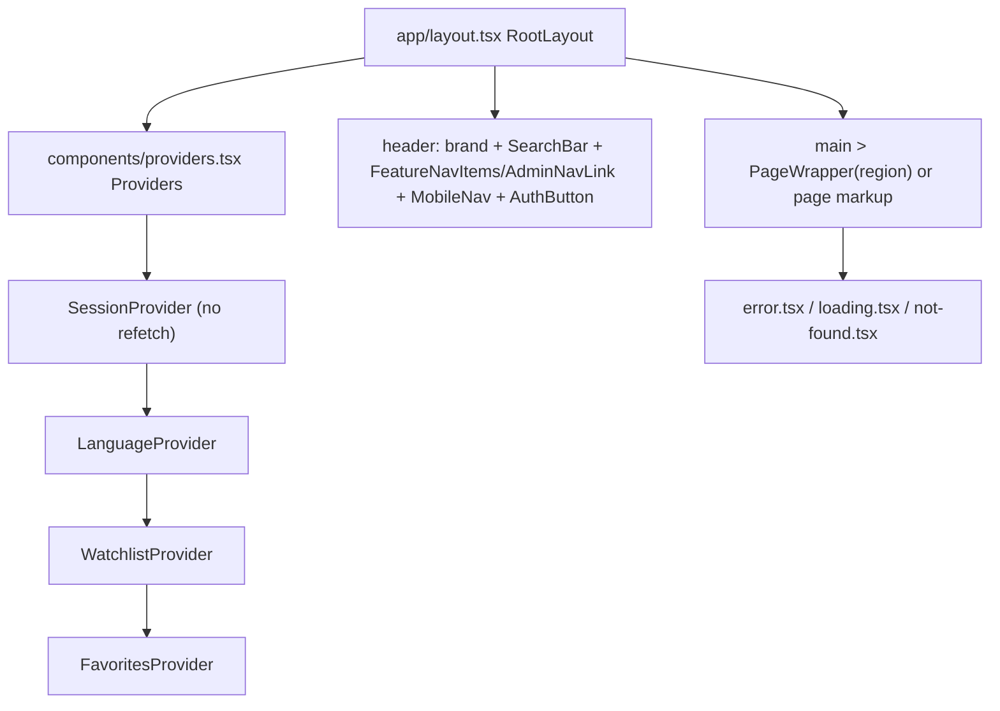
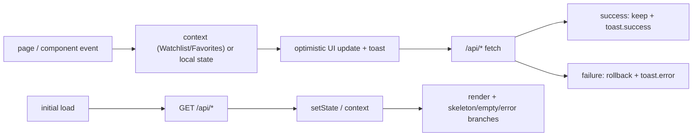
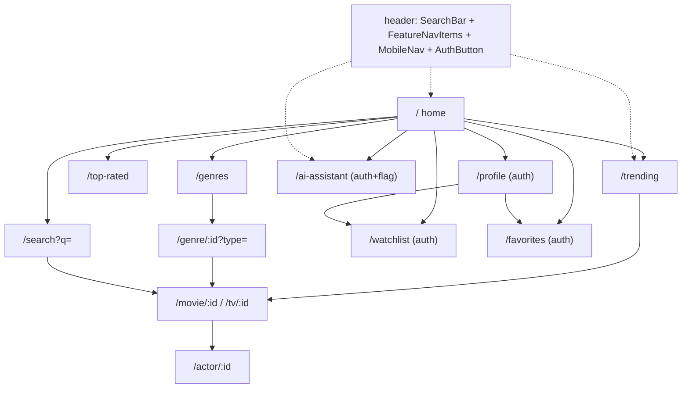
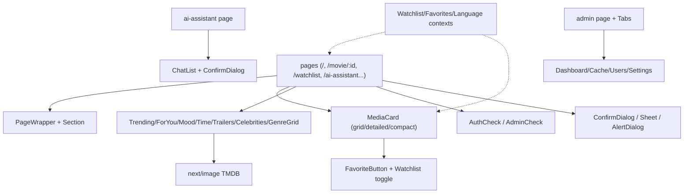
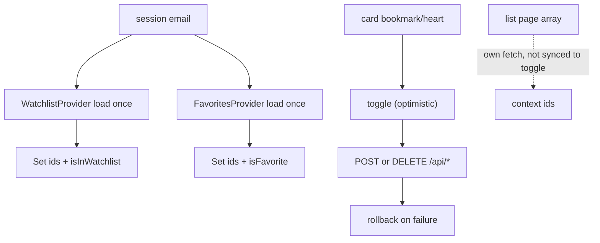

# UI/UX Review — MovieMind (movie-recommendation-system)

## 1. Document control

- **Report purpose:** Portable frontend knowledge package. Reconstruct the implemented UI system (apps, routes, components, state, data flow, styling, a11y, responsive, feedback, tests) so a developer or AI agent without repo access can reason about changes, preserve invariants, and plan work.
- **Repository identifier:** `movie-recommendation-system` (Next.js App Router, single web app).
- **Branch / state:** `main` @ `70fe776` (`chore(docs): ADR-001 consolidation and phase 7 report`).
- **Review date:** 2026-09-10 (UTC).
- **Review type:** Static source review. No browser, screen reader, or profiler run. No screenshots rendered.
- **Scope:** All `app/`, `components/`, `contexts/`, `hooks/`, styling (`app/globals.css`, `tailwind.config.ts`), `middleware.ts`, `next.config.mjs`, `public/`, `tests/` UI suites.
- **Exclusions:** Backend internals (API route logic, DB schemas, auth server code) except where they shape UI behavior; `docs/remediation-archive/` history.
- **Methodology:** Staged inventory (entry → routes → components → state → flows → styling → a11y → responsive → perf → resilience → tests), symbol-level citation, test cross-check (`tests/m5-a11y.test.tsx`, `tests/m6-consistency.test.tsx`, `tests/phase3-ui-flows.test.tsx`, `tests/phase4-watchlist-mobile.test.tsx`), one read-only execution (`npm run typecheck` → pass).
- **Evidence model:** `Verified from source` (code/config/test), `Verified by execution` (typecheck only), `Probable runtime/visual issue`, `Design/UX gap`, `Needs visual verification`, `Needs usability verification`, `N/A`, `Verified strength`.
- **Project-class calibration:** Early-production solo/small-team consumer web app (TMDB-backed discovery + watchlist/favorites + AI chat + admin). Judged as a functional product, not a design-system showcase. Missing Storybook, e2e, PWA, full i18n/RTL is normal at this stage.
- **Overall confidence:** High for architecture/routes/components/state/styling; Medium for responsive/a11y runtime behavior; Low for visual quality, animation smoothness, real contrast, field performance (no rendered evidence).
- **Major limitations:** Source review cannot prove rendered visual quality, runtime behavior, accessibility conformance, usability, or real-user performance. All visual/perf/a11y-runtime claims are labeled accordingly. No app server started, no browser automation, no screenshots.

## 2. Table of contents

- [1. Document control](#1-document-control)
- [2. Table of contents](#2-table-of-contents)
- [3. Executive summary](#3-executive-summary)
- [4. How to use this report with future AI agents](#4-how-to-use-this-report-with-future-ai-agents)
- [5. Frontend scope and coverage](#5-frontend-scope-and-coverage)
- [6. Product context and calibration](#6-product-context-and-calibration)
- [7. Frontend technology stack](#7-frontend-technology-stack)
- [8. Frontend application catalog](#8-frontend-application-catalog)
- [9. Frontend architecture](#9-frontend-architecture)
- [10. Route, screen, and navigation catalog](#10-route-screen-and-navigation-catalog)
- [11. Critical user journeys](#11-critical-user-journeys)
- [12. Component architecture and catalog](#12-component-architecture-and-catalog)
- [13. Design system and visual-language implementation](#13-design-system-and-visual-language-implementation)
- [14. State, data fetching, and synchronization](#14-state-data-fetching-and-synchronization)
- [15. Forms and input experience](#15-forms-and-input-experience)
- [16. UX state coverage](#16-ux-state-coverage)
- [17. Accessibility assessment](#17-accessibility-assessment)
- [18. Responsive and adaptive behavior](#18-responsive-and-adaptive-behavior)
- [19. Localization, RTL, and bidirectional UI](#19-localization-rtl-and-bidirectional-ui)
- [20. Frontend performance assessment](#20-frontend-performance-assessment)
- [21. Motion and micro-interactions](#21-motion-and-micro-interactions)
- [22. Resilience and error UI](#22-resilience-and-error-ui)
- [23. Platform-specific assessment](#23-platform-specific-assessment)
- [24. Frontend testing and observability](#24-frontend-testing-and-observability)
- [25. Findings summary](#25-findings-summary)
- [26. Detailed findings](#26-detailed-findings)
- [27. UX and visual items requiring manual verification](#27-ux-and-visual-items-requiring-manual-verification)
- [28. Accessibility items requiring manual verification](#28-accessibility-items-requiring-manual-verification)
- [29. Positive frontend observations](#29-positive-frontend-observations)
- [30. Reviewed candidates not reported as findings](#30-reviewed-candidates-not-reported-as-findings)
- [31. UI maturity assessment](#31-ui-maturity-assessment)
- [32. Premature complexity tax](#32-premature-complexity-tax)
- [33. Deliberate anti-recommendations](#33-deliberate-anti-recommendations)
- [34. Prioritized improvement roadmap](#34-prioritized-improvement-roadmap)
- [35. Frontend regression test plan](#35-frontend-regression-test-plan)
- [36. Validation and execution report](#36-validation-and-execution-report)
- [37. Coverage and omissions ledger](#37-coverage-and-omissions-ledger)
- [38. Frontend invariants for future development](#38-frontend-invariants-for-future-development)
- [39. Frontend-focused file reading order](#39-frontend-focused-file-reading-order)
- [40. Change-impact guide](#40-change-impact-guide)
- [41. Open frontend questions](#41-open-frontend-questions)
- [42. Glossary](#42-glossary)

## 3. Executive summary

MovieMind is a single Next.js 15 App Router web app: TMDB-backed movie/TV discovery (trending, top-rated, genres, search, detail pages, trailers, celebrities), personal lists (watchlist, favorites, viewing history), an AI chat assistant with persisted conversations, profile/privacy controls, and an admin dashboard. One responsive web surface serves desktop and mobile; mobile gets a Radix Sheet drawer under `md`.

- **Overall UI maturity: 6.9/10** (early-production calibration; weighted toward journeys, resilience, a11y).
- Highest relevant area: Component architecture 8/10 (unified `MediaCard`, shared `Section`/`PageWrapper`/`ConfirmDialog`, Radix-backed overlays).
- Lowest relevant area: Localization/RTL N/A (excluded); lowest scored relevant area: Forms 6/10 (custom controls lack Escape/outside-close, no schema validation client-side).
- Top strengths: labeled card actions with `aria-pressed`; combobox/listbox search semantics; per-screen error+retry; optimistic list toggles with rollback; focus-visible rings; reduced-motion guard.
- Top risks: broken `/images/placeholder-*` fallback paths (404 images on missing posters); movie+TV id collision in list membership sets; detail-page fetch waterfall; silent celebrities failure; auth-gate return-path loss in `AuthCheck`.
- Verification limits: no rendered screenshots, no keyboard/SR run, no profiling; visual, contrast, responsive-breakage, and timing claims are unverified.
- Immediate actions: fix placeholder asset paths; scope list membership by `(type,id)`; parallelize detail fetches; add error state to celebrities page; pass `callbackUrl` in `AuthCheck` sign-in.

| Area | Score | Confidence |
|---|---|---|
| Frontend architecture | 7 | High |
| Component architecture | 8 | High |
| State and data flow | 7 | High |
| Design-system consistency | 6 | High |
| Responsive and adaptive | 7 | Medium |
| Accessibility | 6 | Medium |
| UX-state coverage | 7 | High |
| Forms and input experience | 6 | High |
| Performance readiness | 7 | Medium |
| Resilience | 7 | High |
| Localization and RTL | N/A | High |
| Testing | 6 | High |
| Platform integration | 6 | High |

## 4. How to use this report with future AI agents

- Complements `PROJECT_BLUEPRINT.md` (system/backend) with frontend-only context: routes, components, state ownership, visual tokens, interaction contracts.
- Finding IDs (`FE-*-###`) are stable. Status values: Confirmed from source / Verified by execution / Probable runtime issue / Design or UX gap / Needs visual verification / Needs usability verification.
- Verified = seen in code/config/test output. Everything visual, animated, contrast-based, or timing-based without a screenshot/profile is explicitly unverified.
- For a future UI change, read §39 first, then the route page + components + contexts listed in §10–§12, then the invariants in §38.
- Preserve: `aria-pressed` on toggle buttons, combobox/listbox wiring in `SearchBar`, Radix dialog/focus behavior, `PageWrapper` region (not `<main>`), `Section` landmark pattern, optimistic-rollback toasts.
- Request screenshots/recordings for: any spacing/hierarchy claim, overlays, responsive breakpoints (360/768/1024/1440), dark compositing, focus order, reduced-motion.
- Do not add state libraries, Storybook, animation libs, or token frameworks without a demonstrated problem (§33).

Reusable frontend-context prompt:

```text
Context: MovieMind is a Next.js 15 App Router TMDB client (single responsive web app).
Read docs/UI_UX_REVIEW.md §8–§12 for routes/components, §14 for state ownership
(WatchlistContext/FavoritesContext single sources of truth, optimistic toggle+rollback),
§13 for tokens (Tailwind + CSS vars, dark-only), §38 for invariants.
Change request: <describe UI change + route>. Preserve aria-pressed toggles,
SearchBar combobox wiring, Radix dialog focus behavior, PageWrapper region semantics.
Cite files/symbols touched. Ask for screenshots if visual quality matters.
```

## 5. Frontend scope and coverage

| Dimension | Coverage |
|---|---|
| Applications | 1 web app + 43-file shadcn/Radix `components/ui` primitive set (inventoried, §12) |
| Routes | All 19 `app/**/page.tsx` enumerated with guards and states (§10) |
| Components | ~45 domain components deep-read (cards, nav, sections, chat, lists, admin); ui primitives inventoried |
| Styling | `app/globals.css`, `tailwind.config.ts` fully read |
| State | All 3 contexts + `useFeatures`, `useDebounce`, `useInfiniteScroll` read |
| Data flow | Traced per journey (§11); API handler internals out of scope |
| Tests | 37 files listed; 4 UI suites read in full |
| Generated/vendored | None (no codegen clients, no vendored UI) |
| Excluded | API business logic, DB models, auth server config, remediation-archive history |
| Coverage confidence | High (architecture/components/state), Medium (runtime responsive/a11y), Low (visual/perf field) |

## 6. Product context and calibration

- **Product type:** Consumer content-discovery + personal-library app (browse → detail → save → revisit; AI-assisted discovery).
- **Target users:** General movie/TV viewers; authenticated power users (lists, history, chat); admins (cache/users/settings).
- **Main tasks:** Find trending/top-rated/genre content; search; inspect title detail + trailer + cast; save to watchlist/favorites; chat with AI; manage history/privacy; administer system.
- **Critical journeys:** J1 home→detail→save; J2 search→result→detail; J3 genre browse→type toggle→infinite scroll→detail; J4 auth-gated list management (sort/filter/clear); J5 AI chat (new/select/delete conversation); J6 admin triage.
- **Maturity:** Early production. Evidence: global error/404/loading boundaries, retry states, optimistic updates, admin dashboard, 37 test files, security headers, typecheck-clean. No e2e/visual-regression/RUM yet — appropriate, not penalized.
- **Platform expectations:** Responsive desktop + mobile web. No PWA, no native, no kiosk/TV, no offline-first requirement.
- **Relevant areas:** All except Localization/RTL (minimal catalog, no switcher — N/A with a note), PWA/desktop/extension (N/A).
- **Non-applicable:** i18n switching, RTL layout, service worker/offline shell, native bridges, multi-locale formatting.

## 7. Frontend technology stack

| Concern | Technology | Version/constraint | Active usage evidence | Confidence |
|---|---|---|---|---|
| Framework | Next.js App Router | `^15.5.9` (`package.json::dependencies.next`) | `app/layout.tsx`, 19 `app/**/page.tsx` | High |
| UI runtime | React | `^18.3.1` | All components `'use client'` | High |
| Language/typing | TypeScript | `^5.0.0`, `npm run typecheck` passes (§36) | Typed props/contexts, no `any` in reviewed UI | High |
| Styling | Tailwind CSS | `^3.4.17`, `tailwind.config.ts`, `app/globals.css` | Utility classes + `@layer` tokens | High |
| Primitives | Radix UI + shadcn wrappers | assorted `^1.x/2.x` | `components/ui/*`, `Sheet`, `AlertDialog`, `Tabs`, `Avatar` | High |
| Auth client | next-auth react | `^4.24.15` | `useSession/signIn/signOut` in `AuthButton`, guards, contexts | High |
| Server/client state | Native fetch + React Context | — | `WatchlistContext`, `FavoritesContext`, `LanguageContext`, per-page `fetch` | High |
| Forms | Native inputs + `react-hook-form` (installed, unused in reviewed flows) + `zod` (installed) | `^7.54.1` / `^3.24.1` | No `useForm` call sites in UI flows (grep §36-adjacent) | High |
| Icons | lucide-react | `^0.454.0` | All nav/cards/buttons | High |
| Toasts | react-hot-toast | `^2.5.2` | `<Toaster position="bottom-center">` in `app/layout.tsx:81`; `toast.success/error` in contexts | High |
| Markdown | react-markdown via `SafeMarkdown` | `^9.0.3` | `app/ai-assistant/page.tsx`, `components/ChatAssistant.tsx` | High |
| Charts (admin) | recharts | `^2.15.0` | `components/admin/DashboardOverview.tsx` (kept per `tests/m6-consistency.test.tsx`) | High |
| Images | `next/image` + TMDB/Google remotePatterns, avif/webp | `next.config.mjs::images` | All posters/avatars | High |
| Fonts | `next/font/google` Inter latin | `app/layout.tsx:15` | Single subset; system fallback `Arial, Helvetica` in CSS | High |
| Theming lib | next-themes installed, `ThemeProvider` exists but **not mounted** | `components/theme-provider.tsx` | No import in `app/layout.tsx`/`components/providers.tsx` | High |
| Testing | vitest + Testing Library + jsdom | `^3.2.7` / `^16.3.2` / `^25.0.1` | `tests/` 37 files | High |
| Lint | eslint `next/core-web-vitals` | `eslint.config.mjs` | Flat config, no custom UI rules | High |

## 8. Frontend application catalog

Single application: **MovieMind web** (`app/layout.tsx::RootLayout`).

- **Product role:** Only user surface (discovery + lists + chat + admin).
- **Target platform:** Responsive web (desktop-first content grids, mobile drawer <768px).
- **Entry point:** `app/layout.tsx:26` (`RootLayout` → `<html lang="en">` → `Providers` → sticky header → `<main>` → footer → `Toaster`).
- **Rendering mode:** Client-heavy. Root layout is a server component; nearly every page is `'use client'` with `useEffect` fetch. Exceptions: `app/not-found.tsx`, `app/privacy/page.tsx` (server).
- **Root layout/shell:** `app/layout.tsx:30-84` — brand link, `SearchBar`, desktop `FeatureNavItems` + `AdminNavLink`, `MobileNav`, `AuthButton`, footer with privacy link.
- **Routing:** File-system App Router. No `loading` skeletons at route level beyond `app/loading.tsx` (spinner); per-page loading states implemented locally.
- **Main providers:** `components/providers.tsx::Providers` — `SessionProvider (refetchInterval 0, refetchOnWindowFocus false)` → `LanguageProvider` → `WatchlistProvider` → `FavoritesProvider`. `ThemeProvider` present but unwired (dead code, §30).
- **State systems:** Session (next-auth), Watchlist/Favorites contexts, Language context, `useFeatures` flag, URL params, localStorage recent searches.
- **Styling system:** Tailwind + CSS custom properties; dark-only gradient cinematic theme.
- **Build/test:** `next build` / `vitest run` / `tsc --noEmit` / `eslint .` (`package.json::scripts`).
- **Deployment target:** Not evidenced in frontend scope (see `PROJECT_BLUEPRINT.md`).
- **Status/confidence:** Active, verified from source, High.

## 9. Frontend architecture

- **Runtime entry points:** `app/layout.tsx` (shell) → per-route `page.tsx`. Global boundaries: `app/error.tsx` (digest-only prod logging + retry + home link), `app/loading.tsx` (spinner), `app/not-found.tsx` (branded 404, single primary CTA).
- **Root layouts/shells:** One shell. Header sticky `z-50` with backdrop blur (`app/layout.tsx:35`); `container-fluid` responsive gutters (`app/globals.css:205-225`).
- **Provider hierarchy:**



- **Rendering strategy:** Server shell + client pages. Consequence: first paint depends on client fetches (home hero fetch, section fetches). `TrendingSection` avoids double-fetch via `initialMovies` (`components/TrendingSection.tsx:29-47,93-108`).
- **Routing:** 19 static/dynamic routes (§10). Auth gating two-layer: `middleware.ts` redirects/API 401s + client `AuthCheck`/`AdminCheck`. Feature gating: `aiAssistant` flag checked in middleware (fail-closed), `useFeatures` (fail-closed fallback), page-level redirect.
- **Data flow:**



- **State ownership:** List membership owned by contexts (single fetch each); page-level items (sort/filter/view) owned locally; chat messages owned by page; feature flags owned by hook; locale owned by context (read-only in practice).
- **Business-logic placement:** Good separation overall — toggle/rollback in contexts, parsing in page (`parseMessageContent` in `app/ai-assistant/page.tsx:36`), sorting/filtering in list pages. Leakage: genre page owns dedupe keys + scroll math; movie page owns currency/date formatting inline. Acceptable at this scale.
- **Error boundaries:** Global `error.tsx` + per-page `role=alert` branches + toast feedback. No nested route-level `error.tsx` per segment.
- **Platform integration:** Images remotePatterns pinned (`next.config.mjs:6-22`); CSP locked in prod (`next.config.mjs:23-99`); security headers; no PWA/manifest/SW (N/A).

## 10. Route, screen, and navigation catalog

Conventions: all routes render inside root `<main>`; `PageWrapper` provides `role=region[Page content]` + `Suspense` spinner (not a nested `<main>`, `components/PageWrapper.tsx:10-13`).

| Route | Component | Layout/gate | Purpose / states | Key refs |
|---|---|---|---|---|
| `/` | `app/page.tsx::HomePage` | public; personalized sections gated on `session` | Hero + stats + trending strip; skeletons; hero error+retry; `GenreGrid`, `LatestTrailers`, gated `ForYou/TimeBased/Mood`, `PopularCelebrities` | `app/page.tsx:36-59,210-239` |
| `/movie/[id]` | `app/movie/[id]/page.tsx::MoviePage` | public | Hero (backdrop+poster+meta+overview+budget), trailer, cast, AI-similar + recommendations carousels, back button; spinner; bare error text | `app/movie/[id]/page.tsx:143-199` |
| `/tv/[id]` | `app/tv/[id]/page.tsx::TVShowPage` | public | Mirror of movie detail (seasons/networks), trailer, similar/recommended | `app/tv/[id]/page.tsx:1-80` (structure) |
| `/[mediaType]/[id]` | `app/[mediaType]/[id]/page.tsx::MediaDetailPage` | public redirector | `person→/actor`, `movie→/movie`, `tv→/tv`, else `/`; spinner while redirecting | `app/[mediaType]/[id]/page.tsx:19-31` |
| `/actor/[id]` | `app/actor/[id]/page.tsx::ActorPage` | public | Bio/meta + movie/tv filmography as labeled anchors | `app/actor/[id]/page.tsx:206-290` |
| `/genre/[id]` | `app/genre/[id]/page.tsx::GenrePage` | public, `?type=movie\|tv` | Infinite-scroll grid, type toggle, skeletons, error+retry preserving loaded items | `app/genre/[id]/page.tsx:110-190,273-371` |
| `/genres` | `app/genres/page.tsx::GenresPage` | public | Genre card index; spinner; error+retry | `app/genres/page.tsx:20-58` |
| `/search` | `app/search/page.tsx::SearchPage+SearchResults` | public, `?q=` | 4 states: prompt (no fetch), skeleton, error, no-results, results grid; AbortController per query | `app/search/page.tsx:48-113,160-240` |
| `/trending` | `app/trending/page.tsx::TrendingPage` | public | Full grid; spinner; error/empty branches | `app/trending/page.tsx:26-71` |
| `/top-rated` | `app/top-rated/page.tsx::TopRatedPage` | public | Two stacked sections (movies + TV) | `app/top-rated/page.tsx:6-30` |
| `/celebrities` | `app/celebrities/page.tsx::CelebritiesPage` | public, `?page` append | Paginated grid; spinner first page only; **no error state** (FE-RES-001) | `app/celebrities/page.tsx:24-44` |
| `/watchlist` | `app/watchlist/page.tsx::WatchlistPage` | `middleware` + `AuthCheck` | Sort/filter/search/view-mode/clear-all; empty + no-results; uses `/api/watchlist/details` | `app/watchlist/page.tsx:75-110,204-470` |
| `/favorites` | `app/favorites/page.tsx::FavoritesPage` | `middleware` + `AuthCheck` | Same controls, pink accent; sort limited to date/title (data-backed honesty) | `app/favorites/page.tsx:68-100,155-180` |
| `/profile` | `app/profile/page.tsx::ProfilePage` | client redirect if unauthenticated | Header + Recently Viewed + Watchlist/Favorites previews + `PrivacySettings` | `app/profile/page.tsx:20-100` |
| `/auth/signin` | `app/auth/signin/page.tsx::SignInPage` | public | Provider buttons (Google/email), `callbackUrl: '/'` | `app/auth/signin/page.tsx:52-68` |
| `/ai-assistant` | `app/ai-assistant/page.tsx::AIAssistant` | `middleware` + `AuthCheck` + feature flag | Chat + `ChatList` sidebar; thinking indicator; structured sections; input form | `app/ai-assistant/page.tsx:163-180,419-577` |
| `/admin` | `app/admin/page.tsx::AdminPage` | `middleware` + `AdminCheck` | Tabs: Overview / Cache / Users / Settings | `app/admin/page.tsx:44-123` |
| `/privacy` | `app/privacy/page.tsx::PrivacyPage` | public server page | Policy text; no cert claims | `app/privacy/page.tsx:8-20` |
| `/feature-unavailable` | `app/feature-unavailable/page.tsx::FeatureUnavailable` | public fallback | Fail-closed landing for disabled features | `app/feature-unavailable/page.tsx:8-46` |

Navigation hierarchy:



Reachability: all routes linked from header/nav/cards except `/feature-unavailable` (redirect target) and `/[mediaType]/[id]` (link target from search dropdown). No orphaned screens found; `MovieCard.tsx`/`MovieSkeleton.tsx`/`Avatar.tsx`/`TimeFilter.tsx` are unused legacy components (§30). No deprecated routes.

## 11. Critical user journeys

### J1 — Home → detail → save (verified from source)

1. `/` mounts; `fetchMovies()` GETs `/api/trending` (`app/page.tsx:41-59`); skeletons shown (`app/page.tsx:230-239`); failure → `role=alert` + Try Again refetch.
2. Hero strip cards (`div role=link`, Enter/Space handling, `aria-label=View details for …`, `app/page.tsx:133-178`) or `TrendingSection` poster links push `/movie/:id` or `/tv/:id`.
3. Detail page fetches details → recommendations → ai-similar → similar fallback (`app/movie/[id]/page.tsx:143-188`); `HistoryTracker` POSTs view (`components/HistoryTracker.tsx:29-66`).
4. Bookmark button toggles via `WatchlistContext.toggleWatchlist` — optimistic set update, POST/DELETE, `toast.success`, rollback + `toast.error` on failure (`contexts/WatchlistContext.tsx:95-140`). `aria-pressed` reflects membership; heart via `FavoriteButton` mirrors for favorites (`components/FavoriteButton.tsx:18-38`).

### J2 — Search → result → detail (verified from source)

1. Header `SearchBar` combobox (`role=combobox`, `aria-expanded/controls/activedescendant`, `components/SearchBar.tsx:182-208`); `/` hotkey focuses unless in input (`components/SearchBar.tsx:59-73`); 300ms debounce (`hooks/useDebounce.ts`).
2. `query.length>2` → GET `/api/search` → up to 6 options (`role=option`, `aria-selected`); empty query → recent (localStorage) + trending suggestions; ArrowUp/Down/Enter/Escape handled (`components/SearchBar.tsx:111-141`).
3. Enter with no selection → `/search?q=`; `SearchResults` fetches with `AbortController`, filters to movie/tv, renders prompt/skeleton/error/empty/grid (`app/search/page.tsx:64-240`).
4. Result `<Link>` cards with poster, rating pill, type badge → detail pages.

### J3 — Genre browse → toggle → infinite scroll (verified from source)

1. `GenreGrid` buttons push `/genre/:id?type=movie` (`components/GenreGrid.tsx:31-46`).
2. Page fetches content + genre name in parallel; dedupe by id with `uniqueKey` (`app/genre/[id]/page.tsx:110-162`); 40-cell skeleton grid while loading.
3. Movie/TV toggle re-pushes route with new `type`; scroll listener (100ms debounce, 800px threshold) appends pages filtering `poster_path != null` (`app/genre/[id]/page.tsx:54-96,164-184`).
4. Error branch keeps already-loaded grid + retry via `retryToken` (`app/genre/[id]/page.tsx:190-260`). Gap: no button fallback for keyboard/SR (FE-UX-002).

### J4 — List management: watchlist/favorites (verified from source)

1. Middleware + `AuthCheck` gate; unauthenticated header `signIn()` loses return path in client guard (FE-UX-003; middleware itself sets `callbackUrl`).
2. Pages fetch (`/api/watchlist/details` enriched vs `/api/favorites` stored-only) and normalize `addedAt/createdAt` (`app/watchlist/page.tsx:75-110`, `app/favorites/page.tsx:68-100`).
3. Local search (300ms debounce, Ctrl+F shortcut, Escape clears), sort dropdown (`role=listbox/option`), asc/desc toggle, 3 view modes (`MediaCard` grid/detailed/compact), results count, per-item remove with rollback, Clear-all via `ConfirmDialog` fan-out DELETEs (`app/watchlist/page.tsx:120-200,253-470`).
4. Empty vs no-results states distinct with recovery CTAs.

### J5 — AI chat (verified from source)

1. `/ai-assistant` checks flag → `router.replace('/')` if disabled; `AuthCheck` gates guests (`app/ai-assistant/page.tsx:163-169`).
2. History loads per session; `ChatList` groups by Today/Yesterday/Week/Month/Older with search, collapse toggles, per-chat delete via `ConfirmDialog` (`components/ChatList.tsx:99-260`).
3. Submit POSTs `{message, chatId}` only; server owns history/persistence; response parsed into prose + structured sections; failure appends generic error bubble (`app/ai-assistant/page.tsx:244-310`). Thinking indicator `role=status`, log `role=log` (`app/ai-assistant/page.tsx:463,512`).
4. Lightweight `ChatAssistant` card variant used in tested surfaces (`components/ChatAssistant.tsx:15-80`) with `role=alert` on failed send.

### J6 — Admin triage (inventoried + partially verified)

`AdminCheck` fetches `/api/user` role (`components/AdminCheck.tsx:15-30`); tabs mount `DashboardOverview` (recharts), `CacheManagement`, `UserManagement`, `SystemSettings` (dirty tracking, save). Label-associated inputs verified by `tests/m5-a11y.test.tsx::M5 (d)`.

## 12. Component architecture and catalog

Groups (domain components; `components/ui/*` Radix/shadcn primitives inventoried as a set):

- **Shells/layouts:** `RootLayout`, `Providers`, `PageWrapper` (region+Suspense), `Section` (landmark+accent header), `BackgroundPattern`.
- **Navigation:** `FeatureNavItems` (desktop, active indicator + accent bar, `aria-current` missing — FE-A11Y-007), `MobileNav` (Radix Sheet drawer), `AdminNavLink` (admin-only link), `AuthButton`, `SignInButton`, `AuthRequiredMessage`.
- **Discovery sections:** `TrendingSection` (time-window toggle + hover backdrop), `GenreGrid` (8 static genres), `TopRatedMovies`, `TopRatedTVShows`, `PopularCelebrities`, `ForYouSection`, `TimeBasedMovies`, `MoodBasedRecommendations` + `MoodSelector`, `LatestTrailers`, `GenreCard`.
- **Cards:** `MediaCard` (unified grid/detailed/compact × cyan/pink; NaN-safe guards; `aria-pressed="true"` explicit on remove). Legacy `MovieCard`, `GridItemCard` family deleted (tripwire test).
- **Detail:** `MovieTrailer` (+`SafeYouTubeEmbed`, `TVShowTrailer`), `HistoryTracker` (null-render tracker), `FavoriteButton`, `SafeExternalLink`, `WatchHistory`, `Watchlist`, `Favorites`.
- **Chat:** `ChatAssistant` (card), `ChatList` (grouped history).
- **Overlays/feedback:** `ConfirmDialog` (Radix AlertDialog, cancel-default), `LoadingSpinner` (+`MovieSkeleton`, `Skeleton`), `Toaster` (hot-toast bottom-center).
- **Admin:** `DashboardOverview`, `CacheManagement`, `UserManagement`, `SystemSettings`.
- **Guards:** `AuthCheck` (spinner → `signIn()` → null), `AdminCheck` (spinner → `redirect('/')` if not admin).

Important responsibilities, reuse, findings:

- `MediaCard` (`components/MediaCard.tsx:65-340`): sole card for list pages; props `{item, onRemove, variant, accent}`; image spinner → fade-in; rating/year/runtime guards; remove action always `aria-pressed="true"` with contextual label. Reused 6× across watchlist/favorites/profile previews. Verified strength (§29).
- `SearchBar` (`components/SearchBar.tsx:22-420`): combobox controller + dropdown (results / recents / trending / tips). Reuse: single global instance in header. Verified strength with caveats (FE-FORM-002: options use `div role=option` + `onClick`, no keyboard activation on the option itself — arrow+Enter path works, pointer path works, but option-focus path weak).
- `MobileNav` (`components/layout/MobileNav.tsx:40-167`): Sheet drawer, `aria-expanded/controls`, `aria-current` on active links, auth footer. Covered by `tests/phase4-watchlist-mobile.test.tsx::MobileNav`.
- `TrendingSection`: `initialMovies` zero-fetch mount (perf strength, test-pinned `tests/m5-a11y.test.tsx::M5 (h)`); hover sets fixed backdrop (decorative, `aria-hidden`).
- `ChatList`: grouped rendering + search; delete reveal uses `group-hover` + `group-focus-within` + 44px target (test-pinned). Section collapse headers are clickable `div`s (FE-A11Y-003).
- `ConfirmDialog`: correct destructive pattern everywhere (clear list/history, delete chat/account).
- `PrivacySettings` (`components/PrivacySettings.tsx:18-224`): tracking toggle, clear/export/delete with typed confirmation; inline error/notice regions (politeness not annotated — minor).
- Duplication: watchlist vs favorites pages duplicate ~70% control logic (sort/search/view/clear) with different accents and sort option sets — intentional data-backed divergence (favorites API lacks enrichment), not a merge candidate until APIs converge.
- Dead code: `ThemeProvider` (`components/theme-provider.tsx`), `MovieCard`, `MovieSkeleton`, `Avatar`, `TimeFilter`, `components/index.ts` barrel (if still exporting dead symbols), `useInfiniteScroll` (genre page uses bespoke scroll instead). See §30/§32.



## 13. Design system and visual-language implementation

- **Tokens (explicit):** CSS vars `--background/foreground/card/popover/primary/...`, `--radius`, sidebar set, charts (`app/globals.css:68-146`); canonical accent tokens `--color-accent-cyan #06b6d4`, `--color-accent-pink #ec4899`, `--radius-card 0.75rem` (`app/globals.css:96-101`); Tailwind maps `brand.cyan/pink`, `rounded-card` (`tailwind.config.ts:62-76`). Shadcn `cva` variants for buttons (`components/ui/button.tsx:8-35`).
- **Implemented language:** Dark-only cinematic: `gray-900→gray-800` gradients, grid/scan-line/circuit/dot background utilities (`app/globals.css:9-66`), cyan primary actions, pink favorites accent, glassmorphic cards (`bg-gray-800/30`, `backdrop-blur`, `rounded-3xl/rounded-xl`), `glow-cyan` shadows, gradient headings (`bg-clip-text`).
- **Typography:** Inter latin (`app/layout.tsx:15`) + Arial/Helvetica fallback; no scale config — ad-hoc `text-xs→text-7xl`; uppercase tracking-wider section headers via `Section` (`components/Section.tsx:11-18`).
- **Spacing/sizing:** Tailwind defaults; `container`/`container-fluid` gutters; aspect ratios `aspect-[2/3]`, `aspect-video/square` for media stability.
- **Radii/shadows/z:** `rounded-lg/xl/2xl/3xl` + `rounded-card` token (new code); layered shadows; header `z-50`, dropdown `z-[60]`, card buttons `z-10/20/30`.
- **Icons/assets:** lucide throughout; emoji genre/mood glyphs (`aria-hidden` in `GenreGrid`, `components/GenreGrid.tsx:40`); `public/` holds `favicon.svg`, `google.svg`, placeholders (`placeholder.jpg`, `placeholder-user.jpg`, `placeholder-logo.png`, `moviemind.png`, `images/film-pattern.svg`, `images/default-backdrop.svg`) — but code references `/images/placeholder-poster.png` + `/images/placeholder-avatar.png` which do not exist (FE-A11Y-001).
- **Themes:** Dark-only; `.dark` vars and `next-themes` present but no toggle is mounted — effectively single-theme. No light/high-contrast/forced-colors handling beyond default Radix.
- **Consistency:** Dual-source accents (`brand-cyan` vs `cyan-500` literals) frozen by tests (`tests/m6-consistency.test.tsx` tripwires + `app/globals.css:96-101` comment). Drift is cosmetic, not user-confusing; do not refactor without updating frozen suites (FE-DESIGN-001, Informational).
- **Hard-coded values:** Pervasive but consistent (cyan-500, gray-800/30, rounded-xl). Treated as convention, not defect.
- **Visual-verification limits:** No screenshots; hierarchy/spacing/gradient quality, overlay legibility, truncation with production data unverified (§27).

## 14. State, data fetching, and synchronization

State taxonomy:

| Category | Owner | Source of truth | Notes |
|---|---|---|---|
| Server (lists) | `WatchlistContext`, `FavoritesContext` | GET `/api/watchlist`, `/api/favorites` once per session email | Optimistic toggle + rollback + toasts; `isLoading` flags |
| Server (content) | Page-local `useState` | `/api/trending`, `/movie/:id`, `/genre/:id/content`, `/api/search`, `/api/trailers`, `/api/celebrities`, AI routes | No query client; manual fetch per mount |
| URL | `useSearchParams` + router | `?q`, `?type`, `?page` | Search query, genre type, celebrities page |
| Form/local | Page-local | inputs, sort, view mode, mood/time selection, chat input | Debounced where needed |
| Auth | next-auth `useSession` | session cookie/JWT | Middleware + client guards |
| Feature flag | `useFeatures` | GET `/api/features` | Fail-closed fallback `{aiAssistant:false}` |
| Locale | `LanguageContext` | `GET /api/features → content.defaultLanguage` | Read-only in practice; no switcher UI |
| Persistent device | localStorage | `recent_searches` (max 5) | JSON-guarded parse |
| Derived | `useMemo`/inline | sorted/filtered lists, grouped chats | Recomputed per render; cheap sizes |

Query/mutation behavior: GET-on-mount per section; POST/DELETE for toggles; DELETE fan-out for clear-all; AbortController only on `/search` page; no cancellation elsewhere; no retries except manual Try-Again buttons; no pagination component (genre infinite scroll; celebrities page-append).

Cache: none client-side beyond context sets; `TrendingSection` reuses `initialMovies`; watchlist details route is the enriched cache. No invalidation protocol — toggles update the id set but page-level enriched rows (watchlist page) maintain their own array, so a toggle from a card inside the page does not refresh that page's row data (membership pill updates via context; row persists until refetch — acceptable).

Risks/strengths: strengths — single-fetch contexts (test-pinned), rollback, fail-closed flags, guarded JSON. Risks — (1) id-only membership collides across media types (FE-STATE-001); (2) `FavoritesContext.toggleFavorite` deps include `favoriteIds` causing new identity per toggle vs watchlist's ref-mirror (FE-DATA-002); (3) detail waterfall (FE-DATA-001); (4) no request dedupe across sibling sections hitting `/api/trending` (home hero + `SearchBar` trending suggestions + `PopularCelebrities` each fetch on mount).



## 15. Forms and input experience

Inventory (no schema-driven forms; all native + hand-rolled):

| Form / control | Location | Validation | States | A11y wiring |
|---|---|---|---|---|
| Global search combobox | `components/SearchBar.tsx` | length>2 gating, `encodeURIComponent` | loading spinner, results/empty/recents/trending, tips footer | `role=combobox`, listbox/options, `aria-activedescendant`, label; `/` hotkey |
| List filter search | watchlist/favorites pages | case-insensitive includes, 300ms debounce | results count, clear button, Ctrl+F/Escape shortcuts | `sr-only` labels (`watchlist-search`, `favorites-search`) |
| Sort dropdown | watchlist/favorites | fixed option set | `aria-expanded/haspopup`, `role=listbox/option`, `aria-selected` | Keyboard: buttons focusable; missing Escape/outside-close (FE-FORM-001) |
| Asc/desc + view-mode toggles | same | — | `aria-pressed` | `role=group` with label |
| Chat input | `app/ai-assistant/page.tsx:533-560` | non-empty guard, disabled while loading | thinking indicator, error bubble | `sr-only` label `ai-assistant-message`; send button label via icon context (weak name — FE-A11Y-008) |
| Chat-history search | `components/ChatList.tsx:213-231` | includes on preview text | empty/no-match states | labeled input |
| Privacy delete confirmation | `components/PrivacySettings.tsx:200-221` | must equal `DELETE_MY_ACCOUNT` | inline error/notice, busy labels | `sr-only` label `privacy-delete-confirm` |
| Admin settings/users/cache | `components/admin/*` | dirty-check `JSON.stringify` compare; server-validated | loading/saving/success/error + toasts | Label-associated (test-pinned M5-d) |
| Sign-in | `app/auth/signin/page.tsx` | provider-driven | provider list, no inline errors | Native buttons with names |

Findings: no visible `<label>`s for placeholder-driven inputs (mitigated by `sr-only`/`aria-label` — not defects); no premature error display; no double-submit guards beyond `disabled` (adequate); destructive actions confirmed via dialog or typed phrase (good); chat send icon-button has no discernible accessible name in source (FE-A11Y-008, Medium).

## 16. UX state coverage

Screen-level matrix (I=Implemented appropriate, W=weak, P=partial, M=missing+needed, N/A, RV=needs runtime verification):

| Screen | Loading | Empty | No-results | Error+retry | Success | Offline/retry | Auth-expiry |
|---|---|---|---|---|---|---|---|
| Home `/` | I (skeletons+spinner) | N/A | N/A | I (alert+retry) | I (sections render) | P (no offline copy) | N/A |
| Movie/TV detail | I (spinner) | N/A | N/A | W (bare text, no retry) | I | P | N/A |
| Search page | I (skeleton `role=status`) | I (prompt, no fetch) | I | I | I (count+grid) | P | N/A |
| Genre | I (40 skeletons) | P (empty grid silent) | N/A | I (keeps loaded + retry) | I | P | N/A |
| Genres index | I | P (silent empty) | N/A | I | I | P | N/A |
| Trending/Top-rated | I | I (trending) / P | N/A | I (trending) / M (top-rated silent) | I | P | N/A |
| Celebrities | W (first-page spinner only) | M (silent) | N/A | M (FE-RES-001) | I | M | N/A |
| Watchlist/Favorites | I | I (+CTA) | I (+clear) | I (inline+toast) | I (toasts) | P | I (middleware+AuthCheck) |
| Profile | I | I (per-section) | N/A | P (section-local) | I | P | I |
| AI assistant | I (thinking) | I (blank log + sidebar empty) | I (chat search no-match) | I (error bubble) | I | P | I |
| Admin | I (per-tab) | I | I | I (+toast) | I (+toast) | P | I |
| Signin | N/A | N/A | N/A | M (no provider-error UI) | I | M | N/A |
| 404 / unavailable / error boundary | N/A | N/A | N/A | I | I (CTAs) | N/A | N/A |

Journey-level: J1 I; J2 I; J3 P (no non-scroll fallback); J4 I; J5 I; J6 I.

Feedback: toasts for mutations (bottom-center), inline errors, `ConfirmDialog` for destructive, optimistic add/remove with rollback, no undo (acceptable — actions re-toggleable), no offline banner (genuine gap only if offline use matters — it does not per product context; note as informational).

Main gaps: celebrities silent failure; detail pages lack retry; top-rated sections lack error UI (need to verify `TopRatedMovies/TopRatedTVShows` internals — partially reviewed); no global offline/slow-network messaging (N/A by context, documented).

## 17. Accessibility assessment

Reference: WCAG 2.2 AA (target, not claimed). No AT run. Static evidence only.

**Semantics/structure (strengths):** single `<main>` in layout; `PageWrapper` region not nested main; `Section` renders `<section aria-label>` with heading; 404 uses `section[aria-labelledby]` + `h1`; search results use `ul/li` + `h2`; admin tabs Radix; dialogs Radix (named titles). `lang="en"` set (`app/layout.tsx:31`).

**Keyboard/focus (strengths + gaps):** focus-visible rings on cards/buttons/links/nav/dropdowns; Sheet/AlertDialog give trap+Escape; combobox arrows/Enter/Escape; 44px targets on icon buttons (search clear, chat delete, scroll buttons, genre watchlist). Gaps: FE-A11Y-003 (hero `div role=link` + `ChatList` section `div onClick` + genre scroll has no keyboard equivalent); FE-A11Y-004 (no skip link; no route-change focus — client navigations leave focus on clicked element); FE-A11Y-007 (`FeatureNavItems` active has no `aria-current`, unlike `MobileNav`).

**Names/labels (strengths + gaps):** card links `aria-label=View details for …`; toggles expose pressed + contextual names; inputs labeled (`sr-only` or `aria-label`, M5-d pinned). Gap: chat send button icon-only without `aria-label` (FE-A11Y-008); `FavoriteButton` title/aria omit item name (minor).

**Forms/errors:** inline errors present; `role=alert` on hero/genre/genres errors, chat failure, trending error; `role=status` on skeletons/thinking; chat `role=log`. No error summary/focus-move after failures (minor at this scale).

**Visual a11y (source evidence only):** text over gradients/backdrops (hero, card overlays, stats) — contrast after compositing unverifiable (RV). Color-only meaning: active nav uses accent bar + bg + font weight (good); rating pills use icon+text (good); error states use text + border (good). Target sizes: icon buttons ≥44px where pinned; some desktop-only hover reveals (§27). Text scaling/reflow untested (RV). `prefers-reduced-motion` global kill-switch present (`app/globals.css:243-259`, spinner exempted) — strength; `motion-safe:` used on pulse accents.

**Media:** posters have meaningful `alt` (title or `title poster`); decorative backdrops use `alt=""` + `aria-hidden` (`components/TrendingSection.tsx:119-130`); trailer iframe has title + nocookie domain + lazy (`components/SafeYouTubeEmbed.tsx:28-40`); no autoplay evidenced.

**ARIA/custom widgets:** combobox/listbox/option wiring correct incl. `aria-activedescendant`↔id match (test-pinned M5-c); sort listbox correct roles; toggles use `aria-pressed` (some boolean-valued — harmless; `MediaCard` hardcodes `"true"` correctly for remove-known-in-list). No invalid/redundant ARIA found. Native buttons/links preferred throughout (good).

**Motion:** `animate-pulse` accents gated `motion-safe:` in newer code, global reduce guard covers rest.

Manual testing still required for: focus order, SR announcements, contrast, zoom/reflow, touch targets on device, forced colors (§28).

## 18. Responsive and adaptive behavior

- **Breakpoint source of truth:** Tailwind defaults (`sm/md/lg/xl`), mobile gate `md:hidden` drawer trigger + `hidden md:flex` desktop nav (`app/layout.tsx:55-61`, `components/layout/MobileNav.tsx:155-167`).
- **Layout strategy:** Desktop-first grids collapsing down: cards `grid-cols-2 → sm:3 → md:4 → lg:6`; genre `3→4→6→8→10`; hero right strip `hidden md:flex` with mobile horizontal-scroll fallback (`app/page.tsx:131-208`); detail hero poster `hidden md:block` + mobile stacked poster (`app/movie/[id]/page.tsx:233-370`); AI page `flex-col` shell with fixed `w-80` sidebar (no collapse — FE-RESP-002).
- **Proven-safe:** `container-fluid` gutters at ≤768/≥1024; `min-w-0/truncate/line-clamp` on titles; `overflow-x-auto scrollbar-hide` carousels; scroll buttons always visible on touch (`opacity-100 md:opacity-0 md:group-hover`) — correct touch assumption.
- **Risks (unverified visually):** header crowding at 360–768px (search + auth + hamburger always mounted); AI sidebar squeezing chat on tablets; admin `TabsList` overflow on small screens; ultra-wide hero `-mx-8` bands; dense genre grid at 10 cols on xl (tiny tap targets — posters are large enough visually but unverified).
- **Touch:** 44px targets on key icon controls; carousel buttons 44px; sort dropdown options are text buttons (~36px — minor).
- **Safe areas/viewport units:** no `dvh/safe-area` usage; `h-[80vh]/90vh/min-h-screen` fixed heights may jitter with mobile chrome (RV).
- **Zoom/text scaling:** no evidence of breakage; unverified.

Manual test matrix: 360×740, 768×1024, 1024×768, 1440×900, 2560×1080; portrait+landscape; 200% zoom; iOS Safari + Android Chrome (§27).

## 19. Localization, RTL, and bidirectional UI

Not applicable as a shipped capability. Evidence: `LANGUAGES` catalog has 4 locales with real strings (`contexts/LanguageContext.tsx:9-72`, test-pinned exact set), but no `setLanguage` call site exists anywhere (grep §36-adjacent: only provider + comment), `<html lang="en">` is fixed, and no locale routes, `Intl` formatting, or `dir` handling exist. Dates use hard-coded `en-US` (`toLocaleDateString('en-US',…)` across cards/pages). This is honest dead readiness, not a defect — the M6 comment explicitly documents the stub removal. Do not build a switcher, RTL, or locale pipelines until product requires them. If a locale ships later: wire `setLanguage` + `<html lang>` + persist choice + `Intl` dates + logical properties audit (physical `left/right/ml/mr` used in overlays/nav).

## 20. Frontend performance assessment

Classification legend: M=measured, S=source-confirmed, P=probable risk, O=opportunity, N=needs profiling.

- **Bundles/loading (S/O):** No `next/dynamic` route/component splitting; admin `recharts` ships only on `/admin` via route boundary (fine). Barrel `components/index.ts` may widen imports (unverified — check before touching). Locale catalog tiny. No third-party scripts beyond fonts. `next/image` optimization on with pinned remotes + avif/webp (strength). Fonts: single Inter latin subset, no `display=swap` issue via next/font (good).
- **Images (S):** `fill` + `sizes` + `loading=lazy` below fold, `priority` for hero/first poster; `quality` tuned (70–85); intrinsic stability via aspect classes. Broken fallback paths undermine this (FE-A11Y-001 doubles as perf/correctness).
- **Rendering (S/P):** Context fan-out: `watchlistIds` Set identity changes per toggle re-render all consumers; watchlist mitigates with ref-mirror stable callback (test-pinned), favorites does not (FE-DATA-002). No `memo` — correct default, no evidence of jank. `TrendingSection` hover-backdrop swaps `next/image` per hover (cheap, decorative). No virtualization (list sizes small; fine). Genre scroll listener debounced (good); `useInfiniteScroll` hook unused.
- **Network (S):** Detail waterfall sequential (4 round trips before similar row settles) — biggest real cost (FE-DATA-001). Sibling sections each fetch on home mount (3–6 GETs). No prefetch (`router.prefetch` unused). Search debounced + aborted (good). No pagination component; infinite scroll has no end-of-list announcement (minor SR gap).
- **SSR/hydration:** Client-rendered pages avoid hydration mismatch by construction; `use(params)` unwrap for dynamic segments (correct Next 15 pattern). No streaming/Suspense boundaries per section beyond `PageWrapper` fallback.
- **Web Vitals:** No RUM/field data; LCP likely hero backdrop/poster (optimized, prioritized); CLS mitigated by aspect boxes; INP risk low (small handlers). All values unmeasured — do not quote numbers.

## 21. Motion and micro-interactions

Present, purposeful, restrained: hover lift/scale on cards (`hover:-translate-y-1`, `group-hover:scale-105`), overlay fades, active-nav accent, `animate-pulse` section bars, `animate-gradient-x`/`backgroundPulse` ambient, `fadeInUp` staggered ForYou cards, smooth carousel scrolls, spinner feedback. Durations ~200–500ms. Interruption/reversibility via CSS transitions (fine). No route transitions (fine). Reduced-motion: global guard + `motion-safe:` on key pulses (strength, `app/globals.css:243-259`). No decorative-motion excess. Cost negligible. Verification: smoothness needs device run (RV).

## 22. Resilience and error UI

- **Boundaries:** global `app/error.tsx` (dev logs full error, prod digest-only, retry + home link); `app/not-found.tsx` branded; `app/loading.tsx` spinner; no per-segment error files (acceptable).
- **Fallbacks:** per-screen error+retry (home, search page, genres, genre, trending, watchlist/favorites, ForYou, chat bubble); trailer null-state; search empty states; `SafeExternalLink` renders nothing for unsafe hrefs (fail-closed, good).
- **Retry:** manual Try-Again buttons refetch (home, genres, genre via token); toasts on mutation failure with rollback; no auto-retry/backoff client-side (server `fetchWithRetry` exists for API layer — out of scope).
- **Partial failure:** genre error preserves loaded grid (good); movie page single `error` string blanks whole detail on any sub-fetch failure (weak — FE-RES-002); celebrities has none (FE-RES-001).
- **Offline/session:** no offline banner/queue (N/A by context); session expiry handled by middleware 401 + client guards; `stale-identity`/`session-lifecycle` server tests exist.
- **Work preservation:** chat input cleared on send (lost on failure — partial; failed message text not restored into input); list mutations roll back (good); filter/sort state local-only (fine).
- **Error hygiene:** no stack/message leak to UI (error.tsx digest-only); `console.error` without PII in reviewed UI paths.

## 23. Platform-specific assessment

Web only. PWA/desktop/mobile-native/extension: N/A (no manifest, SW, install prompts, deep-link schemes, window controls — correctly absent).

- **Web:** metadata title/description + `favicon.svg` (`app/layout.tsx:17-24`); semantic landmarks; keyboard support per §17; CSP + hardening headers (`next.config.mjs:23-99`); image domains pinned. Missing: `theme-color`/OG tags/social metadata, `viewport` export (Next defaults apply — fine), sitemap/robots evidence (out of scope).
- **Touch/mobile web:** drawer nav, 44px key targets, horizontal carousels, stacked hero — covered in §18 with RV items.

## 24. Frontend testing and observability

Inventory (`tests/`, 37 files): UI-behavioral — `m5-a11y` (keyboard/labels/live-regions/zero-fetch/keys), `m6-consistency` (MediaCard variants, Section, ConfirmDialog, LANGUAGES tripwire, dead-dep/file tripwires), `phase3-ui-flows` (404, search states, trailer embed), `phase4-watchlist-mobile` (context single-fetch/rollback/DELETE, MobileNav), `favorites-context`, `chat-list-contract`; security/contract suites touching UI trust boundaries (`chat-trust-boundary`, `ai-markdown-security`, `features-fail-closed`, `promote-users-security`, `quota/ratelimit/redis-cache`, `tmdb-proxy-validation`); boot/env/origin/session suites.

- **Critical-flow coverage:** J1 toggle/rollback, J2 search states, J3 genre retry token, J5 chat error alert + live regions, nav drawer — good.
- **Negative paths:** fetch rejects, invalid trailer keys, empty lists, no-match chat search — good.
- **A11y coverage:** semantic roles, labels, focus-reveal, live regions — good statically; no axe/pa11y, no keyboard e2e, no SR run.
- **Gaps:** no e2e (Playwright/Cypress), no visual regression, no responsive/theme/locale matrix, no perf budgets/RUM, noanalytics/error-reporting client evidence (Sentry/etc. absent — acceptable).
- **Realism:** jsdom with mocked `next/link|image|navigation`, stubbed fetch — deterministic; `next/image` `onLoadingComplete` mocked away in M6 (image-load fade path untested — note).
- Do not invent coverage percentages.

## 25. Findings summary

| ID | Title | Status | Severity | Conf. | Area | App | Route/component | Primary location | Priority | Effort |
|---|---|---|---|---|---|---|---|---|---|---|
| FE-A11Y-001 | Broken poster/avatar fallback paths 404 | Confirmed from source | High | High | a11y/resilience | web | all poster grids, cast | `components/MediaCard.tsx:114` | Now | S |
| FE-STATE-001 | Watchlist/favorite membership keyed by id only (movie↔TV collision) | Probable runtime issue | High | Medium | state | web | cards + contexts | `contexts/WatchlistContext.tsx:42` | Now | S |
| FE-DATA-001 | Detail pages fetch waterfall (4 sequential round trips) | Confirmed from source | Medium | High | data/perf | web | movie/TV detail | `app/movie/[id]/page.tsx:143-188` | Next | M |
| FE-RES-001 | Celebrities page has no error state (silent failure) | Confirmed from source | Medium | High | resilience | web | `/celebrities` | `app/celebrities/page.tsx:24-38` | Next | S |
| FE-UX-003 | `AuthCheck` sign-in drops return path | Confirmed from source | Medium | High | UX | web | gated pages | `components/AuthCheck.tsx:11-19` | Next | S |
| FE-A11Y-003 | Non-semantic interactive divs (hero cards, chat section toggles) | Confirmed from source | Medium | High | a11y | web | home hero, `ChatList` | `app/page.tsx:133-156` | Next | S |
| FE-A11Y-008 | Chat send button has no accessible name | Confirmed from source | Medium | High | a11y | web | `/ai-assistant` input | `app/ai-assistant/page.tsx:547-555` | Next | S |
| FE-RES-002 | Detail pages blank on any sub-fetch failure, no retry | Confirmed from source | Medium | High | resilience | web | `/movie/[id]`, `/tv/[id]` | `app/movie/[id]/page.tsx:196-200` | Next | S |
| FE-FORM-001 | Custom sort dropdown never closes on Escape/outside | Probable runtime issue | Medium | Medium | forms | web | watchlist/favorites | `app/watchlist/page.tsx:299-329` | Next | S |
| FE-DATA-002 | `toggleFavorite` identity churn re-renders consumers per toggle | Confirmed from source | Low | High | perf | web | all favorite buttons | `contexts/FavoritesContext.tsx:89-137` | Later | S |
| FE-UX-002 | Genre infinite scroll has no button fallback | Design or UX gap | Medium | High | UX | web | `/genre/[id]` | `app/genre/[id]/page.tsx:164-184` | Later | S |
| FE-RESP-002 | AI sidebar fixed width squeezes chat on narrow screens | Needs visual verification | Medium | Medium | responsive | web | `/ai-assistant` | `app/ai-assistant/page.tsx:444-461` | Later | S |
| FE-A11Y-004 | No skip link; no route-change focus management | Confirmed from source | Medium | High | a11y | web | global shell | `app/layout.tsx:35-71` | Later | S |
| FE-A11Y-007 | Desktop nav active item lacks `aria-current` | Confirmed from source | Low | High | a11y | web | header nav | `components/layout/FeatureNavItems.tsx:55-94` | Later | S |
| FE-UX-001 | Celebrity cards route via `/person/*` extra redirect hop | Confirmed from source | Low | High | UX | web | home celebrities | `components/PopularCelebrities.tsx:36-38` | Optional | S |
| FE-DESIGN-001 | Dual accent sources (`brand-*` vs `cyan-500`) frozen by tests | Confirmed from source | Informational | High | design | web | tokens | `app/globals.css:96-101` | Optional | M |
| FE-TEST-001 | No e2e / visual-regression / RUM | Confirmed from source | Informational | High | testing | web | repo-wide | `package.json::scripts` | Optional | L |

Counts: Critical 0, High 2, Medium 10, Low 3, Informational 2. Confirmed from source 13, Verified by execution 0 (findings; typecheck is not a finding), Probable runtime 2, Design/UX gap 1, Needs visual verification 1, Needs usability verification 0.

## 26. Detailed findings

### [FE-A11Y-001] Broken poster/avatar fallback paths 404

- **Status:** Confirmed from source
- **Severity:** High
- **Confidence:** High
- **Area:** Accessibility / Resilience
- **Affected application:** MovieMind web
- **Affected route or journey:** All poster grids, detail cast, favorites previews (J1–J4)
- **Affected users or viewport:** All users viewing titles without TMDB art; SR users hear title but sighted users see broken image
- **Primary location:** `components/MediaCard.tsx:114`
- **Additional locations:** `components/MediaCard.tsx:205,274`, `app/movie/[id]/page.tsx:509,591,688`, `app/tv/[id]/page.tsx:451,522,614`, `app/actor/[id]/page.tsx:219,270`, `components/ForYouSection.tsx:164`, `components/Favorites.tsx:96`, `components/Avatar.tsx:17-22`
- **Evidence:** Code references `/images/placeholder-poster.png` and `/images/placeholder-avatar.png`; `public/` contains `placeholder.jpg`, `placeholder-user.jpg`, `placeholder-logo.png`, `images/default-backdrop.svg` — neither referenced path exists.
- **Current implementation:** `src={item.posterPath ? tmdb : '/images/placeholder-poster.png'}`.
- **Observed or probable problem:** Missing art requests 404; `next/image` renders broken image instead of designed fallback.
- **User impact:** Visual breakage on exactly the edge case the fallback exists for; erodes trust in lists.
- **Trigger conditions:** Any `poster_path/profile_path == null`.
- **Reach and frequency:** Common for obscure titles/people; every user eventually.
- **Why it matters for this product:** Discovery product lives on posters; lists must look intact.
- **Recommended improvement:** Point fallbacks at existing assets (or add the two missing files) and keep meaningful `alt`.
- **Smallest viable fix:** Replace `/images/placeholder-poster.png` → existing placeholder (e.g. `/placeholder.jpg`) and `/images/placeholder-avatar.png` → `/placeholder-user.jpg`; or add the two files. One-line each.
- **Likely files to change:** `components/MediaCard.tsx`, `components/Avatar.tsx`, `components/Favorites.tsx`, `components/ForYouSection.tsx`, `app/movie/[id]/page.tsx`, `app/tv/[id]/page.tsx`, `app/actor/[id]/page.tsx`
- **Frontend invariant after improvement:** Every `next/image` `src` resolves to a committ
ed asset or pinned remote host.
- **Suggested tests:** Render `MediaCard` with `posterPath: null`, assert `img[src]` equals the committed fallback; add asset-existence tripwire in `m6-consistency`.
- **Manual verification:** Load a known poster-less title; confirm fallback renders at 360/1440.
- **Regression risks:** Snapshot churn on src strings only.
- **Estimated effort:** S
- **Priority:** Now

### [FE-STATE-001] Watchlist/favorite membership keyed by id only (movie↔TV collision)

- **Status:** Probable runtime issue
- **Severity:** High
- **Confidence:** Medium
- **Area:** State
- **Affected application:** MovieMind web
- **Affected route or journey:** J1/J4 — any card where a movie and a TV show share a TMDB id
- **Affected users or viewport:** Authenticated list users
- **Primary location:** `contexts/WatchlistContext.tsx:42`
- **Additional locations:** `contexts/FavoritesContext.tsx:40`, `contexts/WatchlistContext.tsx:82-95`, all `isInWatchlist(id)` / `isFavorite(id)` call sites
- **Evidence:** `watchlistIds: Set<number>` / `favoriteIds: Set<number>` built from `itemId` alone; TMDB movie and TV ids share a namespace in practice.
- **Current implementation:** Membership = `set.has(itemId)`; DELETE does send `type`, but the optimistic set does not distinguish it.
- **Observed or probable problem:** Saving movie #X marks TV #X as saved (and vice versa); toggling one flips the other's pill.
- **User impact:** Wrong saved-state affordance; accidental removals.
- **Trigger conditions:** Same numeric id across types in visible lists.
- **Reach and frequency:** Uncommon per pair, inevitable at catalog scale.
- **Why it matters:** List correctness is the core authenticated value prop.
- **Recommended improvement:** Key sets by `${type}:${id}`; keep numeric helpers as wrappers taking `(type,id)`.
- **Smallest viable fix:** Change both contexts to `Set<string>` with `key = type+':'+itemId`; update `isIn*/toggle*` signatures and call sites.
- **Likely files to change:** `contexts/WatchlistContext.tsx`, `contexts/FavoritesContext.tsx`, ~12 card/section call sites, `tests/phase4-watchlist-mobile.test.tsx`, `tests/favorites-context.test.tsx`
- **Frontend invariant after improvement:** Membership identity always includes media type.
- **Suggested tests:** Seed `{itemId: 42, type: 'movie'}` and assert TV 42 reads `false`; toggle TV 42 independently.
- **Manual verification:** Save a movie, open same-id TV (via direct URL), confirm pill states independent.
- **Regression risks:** All toggle call sites change signature; frozen tests need updates.
- **Estimated effort:** S
- **Priority:** Now

### [FE-DATA-001] Detail pages fetch waterfall (4 sequential round trips)

- **Status:** Confirmed from source
- **Severity:** Medium
- **Confidence:** High
- **Area:** Data / Performance
- **Affected application:** MovieMind web
- **Affected route or journey:** J1 detail (`/movie/[id]`, `/tv/[id]`)
- **Affected users or viewport:** All, worse on slow networks
- **Primary location:** `app/movie/[id]/page.tsx:143-188`
- **Evidence:** `await` chain: details → recommendations → ai-similar → (fallback) similar; each blocks the next.
- **Current implementation:** Sequential awaits inside one effect; single `isLoading` gate.
- **Observed or probable problem:** Similar/recommended rows wait on unrelated AI call; TTI delayed by sum of latencies. Source-confirmed inefficiency, unmeasured timing.
- **User impact:** Slower detail assembly; spinner held longer than necessary.
- **Trigger conditions:** Every detail visit; worse when AI endpoint is slow.
- **Reach and frequency:** Every detail view.
- **Why it matters:** Detail is the highest-intent screen.
- **Recommended improvement:** Fire details + recommendations + similar + ai-similar concurrently (`Promise.allSettled`), render each row as it resolves; keep AI badge conditional.
- **Smallest viable fix:** Parallelize the three secondary fetches; keep sequential only where data depends (none do).
- **Likely files to change:** `app/movie/[id]/page.tsx`, `app/tv/[id]/page.tsx`
- **Frontend invariant after improvement:** Secondary rows never block each other or the hero.
- **Suggested tests:** Mock staggered resolves; assert recommendations render before ai-similar settles.
- **Manual verification:** Throttle to Fast 3G; compare row paint order/timing.
- **Regression risks:** State-update-after-unmount (guard exists via pattern; add cancelled flag).
- **Estimated effort:** M
- **Priority:** Next

### [FE-RES-001] Celebrities page has no error state (silent failure)

- **Status:** Confirmed from source
- **Severity:** Medium
- **Confidence:** High
- **Area:** Resilience
- **Affected application:** MovieMind web
- **Affected route or journey:** `/celebrities`
- **Affected users or viewport:** All
- **Primary location:** `app/celebrities/page.tsx:24-38`
- **Evidence:** `catch { console.error } finally { setIsLoading(false) }` with no `setError`; render path has no error branch (unlike genres/trending/search).
- **Current implementation:** Failure → `isLoading=false`, stale/empty grid, no message.
- **Observed or probable problem:** Users see an empty page with no explanation or recovery.
- **User impact:** Dead-end; no retry.
- **Trigger conditions:** Any `/api/celebrities` non-OK or network failure.
- **Reach and frequency:** Every outage for this route.
- **Why it matters:** Every sibling route has error+retry; inconsistency reads as broken.
- **Recommended improvement:** Add `error` state + `role=alert` + Try Again (copy `app/genres/page.tsx:42-58` pattern).
- **Smallest viable fix:** 15-line error branch + retry refetch.
- **Likely files to change:** `app/celebrities/page.tsx`
- **Frontend invariant after improvement:** Every async major screen has recoverable error feedback.
- **Suggested tests:** Reject fetch; assert `role=alert` + retry re-calls API (mirror `phase3-ui-flows` search tests).
- **Manual verification:** Block `/api/celebrities` in devtools; confirm message + retry.
- **Regression risks:** None.
- **Estimated effort:** S
- **Priority:** Next

### [FE-UX-003] `AuthCheck` sign-in drops return path

- **Status:** Confirmed from source
- **Severity:** Medium
- **Confidence:** High
- **Area:** UX / Auth flow
- **Affected application:** MovieMind web
- **Affected route or journey:** Direct visits to `/watchlist`, `/favorites`, `/ai-assistant`, `/profile` while logged out
- **Affected users or viewport:** Logged-out users following deep links
- **Primary location:** `components/AuthCheck.tsx:11-19`
- **Evidence:** Calls bare `signIn()`; sign-in page uses `callbackUrl: '/'` (`app/auth/signin/page.tsx:55`); middleware redirect for the same routes sets `callbackUrl=pathname` (`middleware.ts:90-96`) but client guard fires first for in-app navigation.
- **Current implementation:** Guard → `signIn()` → lands on `/` after login regardless of origin.
- **Observed or probable problem:** User intent (e.g. shared watchlist link) lost; extra navigation to return.
- **User impact:** Moderate annoyance on the highest-intent entry points.
- **Trigger conditions:** Logged-out deep link rendered client-side past middleware (or middleware skipped).
- **Reach and frequency:** Every logged-out gated deep link via client nav.
- **Why it matters:** Return-path preservation is a stated invariant pattern (middleware already does it).
- **Recommended improvement:** `signIn(undefined, { callbackUrl: window.location.pathname + window.location.search })` in `AuthCheck`.
- **Smallest viable fix:** One-line callbackUrl.
- **Likely files to change:** `components/AuthCheck.tsx`
- **Frontend invariant after improvement:** Post-login navigation preserves the gated return path.
- **Suggested tests:** Render guard unauthenticated with mocked location; assert `signIn` called with current path.
- **Manual verification:** Logged out → `/watchlist` → sign in → land back on `/watchlist`.
- **Regression risks:** Callback open-redirect — restrict to relative paths only.
- **Estimated effort:** S
- **Priority:** Next

### [FE-A11Y-003] Non-semantic interactive divs (hero cards, chat section toggles)

- **Status:** Confirmed from source
- **Severity:** Medium
- **Confidence:** High
- **Area:** Accessibility
- **Affected application:** MovieMind web
- **Affected route or journey:** Home hero strip; AI chat history grouping
- **Affected users or viewport:** Keyboard and screen-reader users
- **Primary location:** `app/page.tsx:133-156`
- **Additional locations:** `app/page.tsx:183-206`, `components/ChatList.tsx:182-199`
- **Evidence:** Hero posters use `div role=link tabIndex=0` with manual Enter/Space; chat group headers use `div onClick` with no role/tabIndex/keyboard handler.
- **Current implementation:** Works for pointer + (hero only) basic keyboard; section toggles pointer-only.
- **Observed or probable problem:** `role=link` divs miss native link behaviors (open-in-new-tab, SR link shortcuts); toggles unreachable by keyboard.
- **User impact:** Reduced operability for keyboard/SR users on prime content.
- **Trigger conditions:** Keyboard-only navigation of hero or chat groups.
- **Reach and frequency:** Every keyboard session.
- **Why it matters:** These are primary discovery/history controls, and native alternatives (`Link`/`button`) are already used elsewhere.
- **Relevant standard:** WCAG 2.2 2.1.1 Keyboard, 4.1.2 Name/Role/Value (applies; conformance not claimed without AT run).
- **Recommended improvement:** Render hero cards as `Link` (like `TrendingSection`) and toggles as `button aria-expanded`.
- **Smallest viable fix:** Swap hero `div`→`Link href`, keep overlay; swap toggle `div`→`button`.
- **Likely files to change:** `app/page.tsx`, `components/ChatList.tsx`
- **Frontend invariant after improvement:** All clickable content uses native interactive elements.
- **Suggested tests:** `getByRole('link', {name})` for hero (already the M5-a pattern for actor cards); `getByRole('button', {expanded})` for toggles.
- **Manual verification:** Tab through hero + chat groups; Enter/Space operate; SR announces links/buttons.
- **Regression risks:** Styling hooks on div classnames; keep classes.
- **Estimated effort:** S
- **Priority:** Next

### [FE-A11Y-008] Chat send button has no accessible name

- **Status:** Confirmed from source
- **Severity:** Medium
- **Confidence:** High
- **Area:** Accessibility
- **Affected application:** MovieMind web
- **Affected route or journey:** J5 `/ai-assistant` message send
- **Affected users or viewport:** Screen-reader users
- **Primary location:** `app/ai-assistant/page.tsx:547-555`
- **Evidence:** Submit `<button type=submit disabled>` contains only `<Send>` icon or spinner, no `aria-label`, no visible text.
- **Current implementation:** Icon-only submit relying on visual context.
- **Observed or probable problem:** SR announces generic "button" with no purpose.
- **User impact:** Send control unidentifiable via SR.
- **Trigger conditions:** Every chat session for SR users.
- **Reach and frequency:** All SR chat usage.
- **Why it matters:** Primary action of a flagship feature.
- **Relevant standard:** WCAG 2.2 4.1.2 Name/Role/Value.
- **Recommended improvement:** Add `aria-label="Send message"`.
- **Smallest viable fix:** One attribute.
- **Likely files to change:** `app/ai-assistant/page.tsx`
- **Frontend invariant after improvement:** Every icon-only button has a discernible name.
- **Suggested tests:** `getByRole('button', {name: /send/i})` on the AI page (mirror M5-e ChatAssistant test).
- **Manual verification:** SR focus on send; name announced; disabled state announced while thinking.
- **Regression risks:** None.
- **Estimated effort:** S
- **Priority:** Next

### [FE-RES-002] Detail pages blank on any sub-fetch failure, no retry

- **Status:** Confirmed from source
- **Severity:** Medium
- **Confidence:** High
- **Area:** Resilience
- **Affected application:** MovieMind web
- **Affected route or journey:** `/movie/[id]`, `/tv/[id]`
- **Affected users or viewport:** All
- **Primary location:** `app/movie/[id]/page.tsx:196-200`
- **Evidence:** Single `error` string set by any of 4 fetches; render is bare `<div class=text-red-500>` with no retry; `if (!movie)` shows indefinite "Loading...".
- **Current implementation:** All-or-nothing detail; secondary failure kills hero.
- **Observed or probable problem:** A failed recommendations call hides the entire title (which already loaded).
- **User impact:** Full dead-end on partial outage.
- **Trigger conditions:** Any secondary endpoint failure.
- **Reach and frequency:** Intermittent, user-visible when it hits.
- **Why it matters:** Hero + trailer + cast are independent of recommendation rows.
- **Recommended improvement:** Isolate failures per section (each row owns error/empty state); add page-level retry.
- **Smallest viable fix:** Render hero when `movie` exists regardless of row errors; add Try Again re-calling the effect.
- **Likely files to change:** `app/movie/[id]/page.tsx`, `app/tv/[id]/page.tsx`
- **Frontend invariant after improvement:** Partial API failure never blanks already-loaded content.
- **Suggested tests:** Resolve details OK + recommendations 500; assert hero present and row shows fallback.
- **Manual verification:** Block recommendations endpoint; hero stays, rows degrade gracefully.
- **Regression risks:** State shape change per row.
- **Estimated effort:** S
- **Priority:** Next

### [FE-FORM-001] Custom sort dropdown never closes on Escape/outside

- **Status:** Probable runtime issue
- **Severity:** Medium
- **Confidence:** Medium
- **Area:** Forms
- **Affected application:** MovieMind web
- **Affected route or journey:** J4 sort on watchlist/favorites
- **Affected users or viewport:** Keyboard users primarily
- **Primary location:** `app/watchlist/page.tsx:299-329`
- **Additional locations:** `app/favorites/page.tsx:394-425`
- **Evidence:** Toggle flips `isFilterOpen`; no `keydown` Escape handler, no outside-click closer (unlike `SearchBar`'s outside handler `components/SearchBar.tsx:76-84`).
- **Current implementation:** Closes only on option select or re-toggle.
- **Observed or probable problem:** Open menu traps visual focus context; Escape does nothing; click-away leaves it open.
- **User impact:** Keyboard annoyance; possible overlap with content.
- **Trigger conditions:** Open sort menu, press Escape or click elsewhere.
- **Reach and frequency:** Every sort use that dismisses abnormally.
- **Why it matters:** Native `select`/Radix menu would do this free; hand-rolled must match.
- **Recommended improvement:** Add Escape + outside-click close (copy SearchBar pattern) or swap to Radix `Select`.
- **Smallest viable fix:** ~10-line effect per page (or shared hook).
- **Likely files to change:** `app/watchlist/page.tsx`, `app/favorites/page.tsx`
- **Frontend invariant after improvement:** Every popup closes on Escape and outside interaction.
- **Suggested tests:** Open menu → Escape → assert closed; click outside → closed.
- **Manual verification:** Keyboard + pointer dismissal at 360/1440.
- **Regression risks:** Shared handler must not fight Ctrl+F shortcut.
- **Estimated effort:** S
- **Priority:** Next

### [FE-DATA-002] `toggleFavorite` identity churn re-renders consumers per toggle

- **Status:** Confirmed from source
- **Severity:** Low
- **Confidence:** High
- **Area:** Performance
- **Affected application:** MovieMind web
- **Affected route or journey:** Any screen with favorite hearts
- **Affected users or viewport:** All (perf only, no correctness issue)
- **Primary location:** `contexts/FavoritesContext.tsx:89-137`
- **Evidence:** Deps `[session?.user?.email, favoriteIds]` recreate `toggleFavorite` (and via `useMemo`, the whole context value) on every toggle; watchlist solved this with `watchlistIdsRef` + `[session?.user?.email]` (`contexts/WatchlistContext.tsx:90-141`, test-pinned).
- **Current implementation:** Correct optimistic toggle + rollback; wasteful identity.
- **Observed or probable problem:** Fleet-wide re-render of memoized consumers per toggle. Source-confirmed inefficiency, no measured jank.
- **User impact:** Negligible today; grows with card density.
- **Trigger conditions:** Any favorite toggle.
- **Reach and frequency:** Per toggle.
- **Why it matters:** The fixed pattern already exists next door; copy it.
- **Recommended improvement:** Mirror the `watchlistIdsRef` pattern in favorites.
- **Smallest viable fix:** Add ref mirror, drop `favoriteIds` dep.
- **Likely files to change:** `contexts/FavoritesContext.tsx`, `tests/favorites-context.test.tsx`
- **Frontend invariant after improvement:** Toggle callbacks are identity-stable across membership changes.
- **Suggested tests:** Assert `toggleFavorite` reference stable across a toggle (mirror M5 stable-keys test).
- **Manual verification:** Profiler: toggle heart, confirm no unrelated subtree renders (optional).
- **Regression risks:** Stale-closure if ref missed — mirror exactly.
- **Estimated effort:** S
- **Priority:** Later

### [FE-UX-002] Genre infinite scroll has no button fallback

- **Status:** Design or UX gap
- **Severity:** Medium
- **Confidence:** High
- **Area:** UX
- **Affected application:** MovieMind web
- **Affected route or journey:** J3 `/genre/[id]` continuation
- **Affected users or viewport:** Keyboard/SR users, no-JS-scroll edge cases
- **Primary location:** `app/genre/[id]/page.tsx:164-184`
- **Evidence:** Scroll listener only; loading-more skeletons gated on `isLoadingMore`; no "Load more" control.
- **Current implementation:** Pointer-scroll-only continuation.
- **Observed or probable problem:** Users who cannot trigger scroll events cannot advance; SR gets no end-of-list status.
- **User impact:** Partial exclusion from long genre lists.
- **Trigger conditions:** Keyboard/SR browsing past page 1.
- **Reach and frequency:** Every non-scroll continuation.
- **Why it matters:** Browse depth is the genre page's job.
- **Recommended improvement:** Add "Load more" button (calls existing `loadMore`) + `aria-live` count; keep infinite scroll as enhancement.
- **Smallest viable fix:** Button under grid when `hasMore && !isLoadingMore`.
- **Likely files to change:** `app/genre/[id]/page.tsx`
- **Frontend invariant after improvement:** All scroll-loaded content has an equivalent explicit control.
- **Suggested tests:** Render with `hasMore`; click button; assert page+1 fetch.
- **Manual verification:** Keyboard-only traversal past page 1; SR announces new count.
- **Regression risks:** Double-fetch if button + scroll race — `loadMore` guards on `isLoadingMore`.
- **Estimated effort:** S
- **Priority:** Later

### [FE-RESP-002] AI sidebar fixed width squeezes chat on narrow screens

- **Status:** Needs visual verification
- **Severity:** Medium
- **Confidence:** Medium
- **Area:** Responsive
- **Affected application:** MovieMind web
- **Affected route or journey:** J5 `/ai-assistant` at 360–768px
- **Affected users or viewport:** Mobile portrait users
- **Primary location:** `app/ai-assistant/page.tsx:444-461`
- **Evidence:** `flex gap-6` with `w-80` sidebar + `flex-1` chat inside `max-w-7xl`; no collapse/hide breakpoint in source.
- **Current implementation:** Sidebar always mounted alongside chat.
- **Observed or probable problem:** At 360px, ~320px sidebar leaves chat unusably narrow. No runtime proof without render.
- **User impact:** Cramped input/messages; horizontal pressure.
- **Trigger conditions:** Viewport < ~700px.
- **Reach and frequency:** Every mobile chat session (if layout holds as read).
- **Why it matters:** Chat is a flagship authenticated feature.
- **Recommended improvement:** Collapse history into a toggleable drawer/tab below `md` (reuse Sheet pattern).
- **Smallest viable fix:** `hidden md:flex` sidebar + "History" toggle opening Sheet on mobile.
- **Likely files to change:** `app/ai-assistant/page.tsx`, possibly `components/layout/MobileNav.tsx` pattern reuse
- **Frontend invariant after improvement:** Chat input area keeps full width on mobile.
- **Suggested tests:** Viewport 360 render; assert sidebar hidden until toggle.
- **Manual verification:** 360×740 + 768×1024 screenshots before/after; verify focus trap in drawer.
- **Regression risks:** Chat selection flow must work from drawer (close on select).
- **Estimated effort:** S
- **Priority:** Later

### [FE-A11Y-004] No skip link; no route-change focus management

- **Status:** Confirmed from source
- **Severity:** Medium
- **Confidence:** High
- **Area:** Accessibility
- **Affected application:** MovieMind web
- **Affected route or journey:** Global, all client navigations
- **Affected users or viewport:** Keyboard/SR users
- **Primary location:** `app/layout.tsx:35-71`
- **Evidence:** No skip-link element; no focus-to-`h1`/main on navigation in any page; App Router preserves focus on client transitions by default.
- **Current implementation:** Header (brand, search, nav, auth) tabbed through on every page arrival.
- **Observed or probable problem:** Extra tab stops per navigation; SR users not told the page changed (no announcer, no focus move).
- **User impact:** Navigation friction; disorientation after route change.
- **Trigger conditions:** Every client-side route change for keyboard/SR.
- **Reach and frequency:** Constant for affected users.
- **Why it matters:** Cheap fix, high daily value for keyboard users.
- **Relevant standard:** WCAG 2.2 2.4.1 Bypass Blocks, 3.2.3 Consistent Navigation (behavioral; needs AT verification for conformance).
- **Recommended improvement:** Add skip-to-content link targeting `#main-content`; move focus to page `h1` on route change (or at minimum `tabIndex=-1` main focus).
- **Smallest viable fix:** Skip link in layout + `id="main-content"` on `<main>`; optional route-change focus effect.
- **Likely files to change:** `app/layout.tsx`
- **Frontend invariant after improvement:** Keyboard users can bypass the header on every page; route changes move context.
- **Suggested tests:** Tab once from top → skip link focused → Enter moves focus to main.
- **Manual verification:** Keyboard run across 3 routes; SR announces new page heading.
- **Regression risks:** Focus outline styling on skip link.
- **Estimated effort:** S
- **Priority:** Later

### [FE-A11Y-007] Desktop nav active item lacks `aria-current`

- **Status:** Confirmed from source
- **Severity:** Low
- **Confidence:** High
- **Area:** Accessibility
- **Affected application:** MovieMind web
- **Affected route or journey:** Header desktop nav (all pages ≥768px)
- **Affected users or viewport:** Screen-reader users
- **Primary location:** `components/layout/FeatureNavItems.tsx:55-94`
- **Evidence:** Active styling (bg, accent bar, `text-cyan-50`) with no `aria-current`; `MobileNav` does set `aria-current={isActive ? 'page' : undefined}` (`components/layout/MobileNav.tsx:97`).
- **Current implementation:** Visual-only current indication on desktop.
- **Observed or probable problem:** SR users get no "current page" announcement on desktop.
- **User impact:** Orientation loss in nav.
- **Trigger conditions:** Every desktop page view for SR.
- **Reach and frequency:** Constant for affected users.
- **Why it matters:** One-attribute fix; mobile already correct — parity gap.
- **Relevant standard:** WCAG 2.2 1.3.1 Info and Relationships.
- **Recommended improvement:** Add `aria-current={isActive ? 'page' : undefined}` to the desktop `Link`.
- **Smallest viable fix:** One attribute.
- **Likely files to change:** `components/layout/FeatureNavItems.tsx`
- **Frontend invariant after improvement:** Current nav item is programmatically determinable on all viewports.
- **Suggested tests:** Render at `/trending`; assert link has `aria-current=page`.
- **Manual verification:** SR nav walk; current announced.
- **Regression risks:** None.
- **Estimated effort:** S
- **Priority:** Later

### [FE-UX-001] Celebrity cards route via `/person/*` extra redirect hop

- **Status:** Confirmed from source
- **Severity:** Low
- **Confidence:** High
- **Area:** UX
- **Affected application:** MovieMind web
- **Affected route or journey:** Home → celebrity (`PopularCelebrities`)
- **Affected users or viewport:** All
- **Primary location:** `components/PopularCelebrities.tsx:36-38`
- **Evidence:** `router.push('/person/'+id)` while canonical route is `/actor/[id]`; `/[mediaType]/[id]` redirector maps `person→/actor` (`app/[mediaType]/[id]/page.tsx:19-31`).
- **Current implementation:** Extra client redirect per click (plus spinner flash).
- **Observed or probable problem:** Slower navigation, history entry noise.
- **User impact:** Minor delay; back-button indirection.
- **Trigger conditions:** Every celebrity card click.
- **Reach and frequency:** Every use of the section.
- **Why it matters:** Direct link costs nothing.
- **Recommended improvement:** Push `/actor/${id}` directly (actor page already uses labeled `Link`s).
- **Smallest viable fix:** One-line href change.
- **Likely files to change:** `components/PopularCelebrities.tsx`
- **Frontend invariant after improvement:** Cards link directly to canonical routes.
- **Suggested tests:** Click celebrity; assert `push` called with `/actor/`.
- **Manual verification:** Click; no intermediate spinner.
- **Regression risks:** None.
- **Estimated effort:** S
- **Priority:** Optional

### [FE-DESIGN-001] Dual accent sources (`brand-*` vs `cyan-500`) frozen by tests

- **Status:** Confirmed from source
- **Severity:** Informational
- **Confidence:** High
- **Area:** Design system
- **Affected application:** MovieMind web
- **Affected route or journey:** Repo-wide theming
- **Affected users or viewport:** Maintainers
- **Primary location:** `app/globals.css:96-101`
- **Additional locations:** `tailwind.config.ts:62-76`, `tests/m6-consistency.test.tsx`
- **Evidence:** Tokens `brand-cyan/pink` equal `cyan-500/pink-500` values; comment states existing call sites intentionally untouched because frozen suites assert literals.
- **Current implementation:** Two names, one value; new code should use tokens.
- **Observed or probable problem:** None user-facing; mild maintainer confusion.
- **User impact:** None.
- **Trigger conditions:** Theme-wide accent change (must edit two places).
- **Reach and frequency:** Rare.
- **Why it matters:** Documents why not to "clean up" literals wholesale.
- **Recommended improvement:** Nothing now. On next accent change, migrate literals to tokens and update frozen suites together.
- **Smallest viable fix:** None.
- **Likely files to change:** N/A
- **Frontend invariant after improvement:** Token and literal stay value-identical until joint migration.
- **Suggested tests:** Existing tripwires already pin this.
- **Manual verification:** None.
- **Regression risks:** Mass replace breaks frozen suites.
- **Estimated effort:** M
- **Priority:** Optional

### [FE-TEST-001] No e2e / visual-regression / RUM

- **Status:** Confirmed from source
- **Severity:** Informational
- **Confidence:** High
- **Area:** Testing
- **Affected application:** MovieMind web
- **Affected route or journey:** Repo-wide journeys J1–J6
- **Affected users or viewport:** Maintainers / release safety
- **Primary location:** `package.json::scripts`
- **Evidence:** Scripts offer `lint/typecheck/test/build` only; `tests/` is jsdom unit/integration; no Playwright/Cypress, no screenshot baselines, no RUM client.
- **Current implementation:** Strong contract/unit layer for components and trust boundaries.
- **Observed or probable problem:** Cross-page flows, real keyboard, responsive, and visual regressions unwatched.
- **User impact:** Indirect (escape risk).
- **Trigger conditions:** Any cross-cutting UI change.
- **Reach and frequency:** Per release.
- **Why it matters:** Calibrated as next-step investment, not a current defect.
- **Recommended improvement:** Add 3–5 Playwright journeys (J1/J2/J4/J5) + axe pass when the team can sustain it; defer visual regression until design stabilizes.
- **Smallest viable fix:** None now.
- **Likely files to change:** N/A (new `e2e/` later)
- **Frontend invariant after improvement:** Critical journeys green on real browser before merge.
- **Suggested tests:** See §35.
- **Manual verification:** N/A.
- **Regression risks:** Flake if selectors couple to styling — use role-based locators.
- **Estimated effort:** L
- **Priority:** Optional

## 27. UX and visual items requiring manual verification

| ID | Question | Why source insufficient | Route/component | Viewport | State/data | Safe steps | Expected | Evidence | Impact |
|---|---|---|---|---|---|---|---|---|---|
| V-01 | Does the hero read clearly over backdrops at all densities? | Gradient compositing unknowable statically | `/` hero | 360/768/1440 | loaded trending | Load home, inspect title/stats/buttons over art | Legible, no washed text | Screenshots | High |
| V-02 | Do hover-only overlays (ratings, reasoning) exclude touch users? | Hover visibility ≠ touch availability | cards, `TrendingSection`, `ForYouSection` | touch 360 | loaded | Tap card on mobile; check info access | Key info reachable without hover | Recording | Medium |
| V-03 | Header crowded at 360–768px? | Flex crowding needs render | global header | 360/768 | anon + authed | Load both states; tab through | No overlap/clipping | Screenshots | Medium |
| V-04 | AI sidebar usable on mobile? | Fixed `w-80` needs render (FE-RESP-002) | `/ai-assistant` | 360 | with chats | Open chat; read + type | Full-width input, history reachable | Screenshots | Medium |
| V-05 | Trailer modal/close behavior sound? | Outside-click vs Escape/focus unverified | `LatestTrailers` | 768/1440 | with trailer | Open trailer; Escape; click outside; Tab | Predictable close, focus restored | Recording | Medium |
| V-06 | Genre 10-col grid tappable; images uncropped badly? | Density needs render | `/genre/[id]` | 1440 + 360 | page 2+ | Scroll to page 3 | Targets comfortable, faces/posters sane | Screenshots | Low |
| V-07 | Admin tabs fit 360px? | TabsList overflow unverified | `/admin` | 360 | admin | Switch all 4 tabs | No clipped tabs | Screenshots | Low |
| V-08 | Long titles/bios truncate gracefully? | Production strings vary | search, detail, actor | 360/1440 | long data | Search long-title item; open actor bio | Ellipsis/wrap, no overlap | Screenshots | Low |
| V-09 | Toasts readable + non-blocking? | Timing/position needs run | any mutation | 360/1440 | authed toggle | Toggle save; observe bottom-center toast | Announces, auto-dismisses, clickable beneath | Recording | Low |
| V-10 | Ambient animation tasteful on device? | Smoothness needs GPU run | `/`, cards | mid-tier mobile | loaded | Scroll home slowly | No jank, reduced-motion honored | Recording + OS reduce-motion on | Low |

## 28. Accessibility items requiring manual verification

- **Keyboard:** Full Tab/Shift-Tab/Enter/Space/Escape walk: header → hero → sections → cards → dropdowns → dialogs → chat. Confirm: hero cards operable (post FE-A11Y-003 fix), sort menu Escape/outside close, drawer trap + focus restore, dialog focus defaults to Cancel, chat send reachable, no positive `tabindex`, no hidden focusables.
- **Screen reader (NVDA+Chrome/Firefox, VoiceOver+Safari):** Page titles announced; nav current announced (post FE-A11Y-007); combobox options + `activedescendant` tracked; sort `listbox` announced; `role=alert/status/log` announce errors/loading/chat; card toggles announce pressed+name; chat send named (post FE-A11Y-008); filmography links named; no `role=link`-div confusion (post fix).
- **Zoom/reflow:** 200% browser zoom + 320px CSS width: no horizontal scroll (except intentional carousels), no clipped CTAs, admin tabs reachable, AI chat usable.
- **Contrast:** Measure text/controls over gradients, overlay gradients, pills, toasts with a color picker on real composites (do not trust hex math on gradients). Target WCAG AA 4.5:1 text / 3:1 non-text.
- **Forced colors / high contrast (Windows HCM):** Overlays, focus rings, accent bars, pills remain perceivable; gradients degrade sanely.
- **Reduced motion:** OS reduce-motion on → ambient/pulse/stagger off, spinners retained, smooth scroll instant.
- **Touch targets:** On-device audit: 44×44 CSS px for icon buttons, sort options, carousel arrows, genre cells, chat send.

## 29. Positive frontend observations

- **Unified `MediaCard` with NaN-safe guards** (`components/MediaCard.tsx:65-95,111-189`) — one component replaces six legacy cards (deletion tripwire-guarded); explicit `aria-pressed="true"`, contextual remove labels, rating/runtime/year guards. Value: consistent lists, fewer variants. Tests: `m6-consistency` 3 variants. Limits: id-only identity (FE-STATE-001).
- **Search combobox semantics** (`components/SearchBar.tsx:182-260`) — listbox/options, activedescendant tracking, keyboard map, hotkey, debounced + trending/recent states. Tests: M5-c. Limits: option activation via div click (FE-FORM-002 minor, folded into FE-A11Y-003 class).
- **Zero-fetch `TrendingSection` mount** (`components/TrendingSection.tsx:93-108`) — reuses `initialMovies`; time-window refetch only on demand. Tests: M5-h. Value: one fewer waterfall on home.
- **Optimistic toggles with rollback + toasts** (`contexts/WatchlistContext.tsx:95-140`, `contexts/FavoritesContext.tsx:89-133`) — single-fetch contexts (phase4-pinned), user stays oriented on failure.
- **Radix-backed overlays** (`ConfirmDialog`, `MobileNav` Sheet, admin Tabs) — focus trap, Escape, announcements free; destructive actions confirmed or typed.
- **Per-screen error+retry honesty** (home, genres, genre-keeps-loaded, search, trending) — recoverable, role-annotated; M5 f/g pinned.
- **Reduced-motion guard** (`app/globals.css:243-259`) — global neutralize with spinner exemption; `motion-safe:` on pulses.
- **Fail-closed feature gating** (`middleware.ts:25-50`, `hooks/useFeatures.ts:30-44`) — deny on config failure; test-pinned.
- **Image discipline** (`next.config.mjs:6-22`, sizes/lazy/priority) — pinned remotes, modern formats; undermined only by fallback paths (FE-A11Y-001).
- **Security-hygienic error UI** (`app/error.tsx:8-29`) — digest-only in prod, no PII/leak; safe trailer/link embeds (`SafeYouTubeEmbed`, `SafeExternalLink`).

## 30. Reviewed candidates not reported as findings

- **`ThemeProvider` unused but harmless** (`components/theme-provider.tsx`): dead export, never mounted. Not a finding — zero runtime cost (tree-shaken), removal optional cleanup. Delete only with its file + any barrel line.
- **Legacy `MovieCard`/`MovieSkeleton`/`Avatar`/`TimeFilter` unused:** confirmed no imports (except `Avatar` internal fallback). Not findings — same reasoning; `m6-consistency` already guards the deleted card family.
- **`useInfiniteScroll` unused:** genre page uses bespoke scroll; hook is inert. Not a finding.
- **`react-hook-form`/`zod` installed but unused in UI:** not a finding — backend/validation may use zod; adding form libs to UI not justified.
- **No `memo`/`useMemo` on cards:** not a finding — no evidence of meaningful render cost; contexts already limit fetches.
- **Hard-coded cyan/gray literals:** convention, not defect (§13, FE-DESIGN-001 informational only).
- **Large `movie/[id]` + `tv/[id]` pages (~740/590 lines):** cohesive detail screens, not god-components; split only if rows gain independent data ownership (FE-DATA-001 fix may naturally extract row components).
- **Missing Storybook:** correctly not recommended (§33).
- **Missing i18n switcher/RTL:** correctly N/A (§19).
- **Missing PWA/offline:** correctly N/A (§23).
- **`aria-pressed={boolean}` on toggle buttons:** valid ARIA (true/false); only `MediaCard` remove hardcodes `"true"` which is correct for its known-in-list semantics.

## 31. UI maturity assessment

- **Overall: 6.9/10**, early-production calibration. Weighting: journeys + resilience + a11y 50%, architecture/state 30%, craft (design/responsive/forms/motion) 20%. Testing/platform gate but don't dominate.
- Per-area: §3 table. N/A excluded from weighting (i18n/RTL, PWA/desktop/extension).
- Top 3 strengths: (1) component unification + Radix overlays; (2) search + list-management interaction completeness; (3) error/rollback honesty with test pins.
- Top 5 risks: broken fallbacks; id-collision membership; detail waterfall; celebrities silence; return-path loss.
- Largest UX gaps: mobile AI layout (unverified), genre keyboard continuation, detail partial-failure blanking.
- Largest engineering gaps: id-scoped identity, parallel detail fetching, dropdown dismissal, favorites callback stability.
- Confidence: High on code claims; Medium overall due to zero runtime/visual/AT evidence.
- Limits: no screenshots, no keyboard/SR run, no profiling, no field data — scores reflect source-visible quality with runtime caution.

## 32. Premature complexity tax

Little. The codebase resists over-abstraction: no state library (Context suffices), no Storybook, no animation lib, no token framework beyond CSS vars, no micro-frontends, no config engines. Minor existing tax:

- Dual accent naming (`brand-*` + literals) — cost ~zero runtime, small cognitive; frozen by tests; leave until accent change forces joint migration.
- Watchlist vs favorites page duplication (~70% controls) — justified by divergent APIs (enriched vs stored-only); merging now would couple to the weaker contract. Revisit if `/api/favorites` gains enrichment.
- Bespoke genre scroll + unused `useInfiniteScroll` hook — tiny dead surface; delete hook or adopt it when adding the Load-more button.
- Unmounted `ThemeProvider` + unused legacy components — inert; batch-delete in a cleanup PR with tripwire updates, not as drive-by edits.

## 33. Deliberate anti-recommendations

- **Do not add Redux/Zustand/TanStack Query.** Why: 2 small contexts + local fetches cover current scale; single-fetch + rollback already work. Cost: migration churn, cache-invalidation ownership. Reconsider when: cross-page normalized cache or background refetch becomes a stated need.
- **Do not add Storybook/Chromatic.** Why: one app, unified cards, no shared-package consumers. Cost: stories rot without owners. Reconsider when: second app consumes the card system.
- **Do not add framer-motion/GSAP.** Why: CSS transitions cover current motion; reduced-motion already handled. Cost: bundle + motion-tax. Reconsider when: choreographed route/shared-element transitions ship.
- **Do not build i18n switcher/RTL now.** Why: no switcher call site, fixed `lang="en"`, en-US dates honest. Cost: translation pipeline + logical-property audit + test matrix. Reconsider when: a non-English locale is staffed.
- **Do not add PWA/SW/offline queue.** Why: online discovery product; no offline requirement evidenced. Cost: stale-shell bugs. Reconsider when: offline-first requirement appears.
- **Do not extract a `@ui` package.** Why: single consumer. Cost: versioning friction. Reconsider when: second surface reuses primitives.
- **Do not virtualize lists.** Why: page sizes small (6–40); no scroll-jank evidence. Cost: a11y/focus complexity. Reconsider when: profiling shows list cost.

## 34. Prioritized improvement roadmap

### Now

- **Fix fallback assets (FE-A11Y-001).** Value: unbreak missing-art states. Files: 7 listed in finding. Effort S. Owner: frontend. Validation: null-poster render test + visual check. Risk: snapshot src churn.
- **Scope membership by type (FE-STATE-001).** Value: list correctness. Files: 2 contexts + call sites + 2 test files. Effort S. Owner: frontend. Validation: cross-type independence test. Risk: signature migration.

### Next

- **Parallelize detail fetches (FE-DATA-001, M).** Row-level resolve; keep AI badge. Validation: staggered-mock test + 3G timing.
- **Celebrities error+retry (FE-RES-001, S).** Copy genres pattern.
- **AuthCheck callbackUrl (FE-UX-003, S).** Relative-path only.
- **Native hero links + labeled send (FE-A11Y-003 part, FE-A11Y-008, S).** Link swap + `aria-label`.
- **Detail partial-failure isolation (FE-RES-002, S).** Hero independent of rows.
- **Dropdown dismissal (FE-FORM-001, S).** Escape + outside close, both list pages.

### Later

- **Genre Load-more button (FE-UX-002, S).** Explicit control + live count.
- **AI mobile layout (FE-RESP-002, S).** Drawer history below `md`.
- **Skip link + route focus (FE-A11Y-004, S).** Layout-level.
- **Favorites callback stability (FE-DATA-002, S).** Ref mirror parity.
- **Desktop `aria-current` (FE-A11Y-007, S).** One attribute.

### Optional

- **Celebrity direct links (FE-UX-001, S).** `/actor/` directly.
- **E2E seed (FE-TEST-001, L).** 3–5 Playwright journeys + axe; defer visual regression.

## 35. Frontend regression test plan

Map (vitest/jsdom now; Playwright later):

| Test | Findings | Journey/states | Viewports/themes | Invariant |
|---|---|---|---|---|
| Null-poster `MediaCard` fallback src | FE-A11Y-001 | J4 grid, missing art | 360/1440 dark | Fallback resolves to committed asset |
| Cross-type membership independence | FE-STATE-001 | J1 toggle movie+TV same id | — | Identity includes type |
| Detail staggered resolve | FE-DATA-001/002 | J1 hero + rows | 3G | Rows resolve independently |
| Celebrities reject → alert + retry | FE-RES-001 | error state | — | Every async screen recoverable |
| Guard preserves return path | FE-UX-003 | gated deep link | — | Post-login returns |
| Hero keyboard operability | FE-A11Y-003 | J1 hero | 360/1440 | Native interactive elements |
| Send button named | FE-A11Y-008 | J5 | — | Icon buttons named |
| Sort menu dismissal | FE-FORM-001 | J4 | — | Popups close on Escape/outside |
| Genre Load-more | FE-UX-002 | J3 page 2 | — | Explicit continuation control |
| Labeled-input sweep (extend M5-d) | — | admin/privacy/chat | — | New inputs labeled |
| Focus trap/restore sweep (extend phase4) | — | drawer/dialogs | 360/1440 | Focus returns to trigger |
| Reduced-motion render | — | home/cards | reduce-motion | No ambient motion, spinners live |

Do not add tests to the repo in this review (boundary). Future e2e: J1 save flow, J2 search→detail, J4 sort/clear, J5 new chat, admin tab smoke — role-based locators, axe pass, 360/1440.

## 36. Validation and execution report

### Executed successfully

- **Command:** `npm run typecheck` — **Working directory:** repo root — **Purpose:** prove no type breakage in scope (read-only `tsc --noEmit`) — **Result:** exit 0, clean — **Proves:** static type soundness at review commit — **Does not prove:** runtime, visual, a11y, or perf behavior.

### Executed with findings or failures

- None.

### Not executed

- `npm run lint` — reason: unnecessary for read-only review; static inspection of `eslint.config.mjs` sufficed. Manual alternative: run before any fix PR.
- `npm test` (vitest) — reason: 37 suites take minutes and several assert exact current behavior (frozen tripwires); outcomes would pin the present, not reveal UI truth beyond what was read. Manual alternative: run the 4 UI suites before editing cards/nav/search.
- `npm run build` — reason: writes `.next/` artifacts (boundary discourages generated-artifact churn); typecheck + source reads suffice. Manual alternative: build in CI.
- Browser/SR/profile runs — reason: no controlled runtime available; would need screenshots, AT, and profilers. Manual alternative: §27/§28 matrices.
- Any command inspecting `full behavior` of scripts (`setup-db`, `test-redis`) — reason: touches external systems. Not relevant to frontend.

### Not applicable

- Screenshot/visual-regression, RUM/field perf, backend migration checks — no such infrastructure in repo.

Repository-change ledger: **Files created:** `docs/UI_UX_REVIEW.md`. **Files modified:** none. **Files deleted:** none. **Dependencies installed:** none. **Lockfiles changed:** none. **Snapshots updated:** none. **Generated artifacts changed:** none. **Commits/branches created:** none. **Deployment actions:** none. **External systems accessed:** none. **External state changes:** none.

## 37. Coverage and omissions ledger

- **Deeply reviewed:** shell, all 19 routes, domain components (~45), 3 contexts, 3 hooks, styling/config/middleware, 4 UI test suites, toasts/dialogs/forms per flow.
- **Partially reviewed:** `components/ui/*` (inventoried by export scan + spot reads: button, dialog, sheet, form, loading), `TVShowTrailer`, `TopRatedMovies/TVShows` internals, admin tab internals, `MoodSelector`, `GenreCard`, actor/TV page tails (structure + key excerpts read; line-level claims limited to cited ranges).
- **Inventoried only:** remaining `tests/` security suites (titles + relevance), `public/` assets (names), API handler bodies, `lib/` data layer.
- **Excluded:** backend logic, DB, auth server, remediation-archive.
- **Generated/vendored:** none found.
- **Missing:** screenshots, design references, runtime env, production data, analytics, field perf, user research — all documented as RV/RU items; confidence adjusted, no claims fabricated.

## 38. Frontend invariants for future development

- **List membership identity includes media type.** Enforcement: none yet (FE-STATE-001 open). Files: `contexts/*Context.tsx`. Tests: to add. Risk: wrong saved pills, accidental deletes.
- **Every async major screen provides recoverable error feedback.** Enforcement: pattern in home/search/genres/genre/trending/lists; missing in celebrities/detail-rows. Files: `app/*/page.tsx`. Risk: dead-ends on partial outage.
- **Toggles expose `aria-pressed` + contextual names; icon-only buttons are named.** Enforcement: `MediaCard`, `FavoriteButton`, M5/M6 tests. Risk: SR-operability regression.
- **`SearchBar` combobox wiring stays intact** (`role`, listbox/options, activedescendant↔id). Files: `components/SearchBar.tsx`. Tests: M5-c. Risk: keyboard search breakage.
- **Overlays use Radix (trap + Escape + restore); Cancel stays default.** Files: `ConfirmDialog`, `MobileNav` Sheet. Risk: focus loss, accidental destructive confirms.
- **`PageWrapper` remains a region, never a nested `<main>`.** Files: `components/PageWrapper.tsx`, `app/layout.tsx`. Risk: landmark invalidity.
- **Post-login navigation preserves gated return paths.** Enforcement: middleware does; `AuthCheck` must (FE-UX-003 open). Risk: deep-link intent loss.
- **Image sources stay pinned (TMDB/Google) or committed assets.** Files: `next.config.mjs`, card/detail components. Risk: CSP breaks, 404 fallbacks.
- **Optimistic mutations roll back with user feedback.** Enforcement: contexts + toasts. Risk: phantom saved states.
- **Reduced-motion stays honored; spinners stay exempt.** Files: `app/globals.css`. Risk: vestibular harm, lost status feedback.
- **Token/literal parity holds until joint migration.** Files: `app/globals.css`, `tailwind.config.ts`, M6 tripwires. Risk: theme drift + test breakage.

## 39. Frontend-focused file reading order

1. `app/layout.tsx` — shell, header, providers mount; routes affected: all. Skim suffices unless touching shell/nav.
2. `components/providers.tsx` — provider order/flags; whole file (22 lines) required for state changes.
3. `app/page.tsx` — home composition + hero patterns; related: `TrendingSection`, `GenreGrid`, personalized sections. Read fully for home changes.
4. `components/SearchBar.tsx` — combobox contract; whole file needed for search changes (420 lines).
5. `components/MediaCard.tsx` — card variants/accents/guards; whole file for card changes.
6. `contexts/WatchlistContext.tsx` + `contexts/FavoritesContext.tsx` — toggle/rollback/identity; whole files for list-state changes.
7. `app/watchlist/page.tsx` + `app/favorites/page.tsx` — controls matrix; read one fully, diff the other.
8. `app/movie/[id]/page.tsx` — detail waterfall + carousels; related findings FE-DATA-001/RES-002.
9. `app/ai-assistant/page.tsx` + `components/ChatList.tsx` — chat + history; whole chat file for chat changes.
10. `components/layout/MobileNav.tsx` + `components/layout/FeatureNavItems.tsx` — nav parity (`aria-current` gap).
11. `components/Section.tsx` + `components/PageWrapper.tsx` + `components/ConfirmDialog.tsx` — shared contracts (short; read fully once).
12. `app/globals.css` + `tailwind.config.ts` — tokens/utilities; read token regions for styling changes.
13. `middleware.ts` + `hooks/useFeatures.ts` — gates/flags; required for auth/feature changes.
14. `tests/m5-a11y.test.tsx` + `tests/m6-consistency.test.tsx` — frozen expectations that constrain edits (accent literals, labels, keys).
15. `next.config.mjs` — images/CSP; required for asset/embed changes.

## 40. Change-impact guide

- **Adding a route:** touch `app/<route>/page.tsx` (+ `middleware.ts` matcher if gated, `FeatureNavItems`/`MobileNav` if nav-visible). Tests: extend M5-style label/role checks. Invariants: region semantics, error+retry, focus. Risks: unreachable route (no nav link), missing gate.
- **Adding a screen:** compose `PageWrapper` + `Section` + existing sections/cards; state via context or local fetch. Tests: loading/empty/error/success branches. Risks: new fetch waterfall, missing skeletons.
- **Adding a nav item:** `FeatureNavItems` + `MobileNav` + `contexts/LanguageContext.tsx` strings; keep `aria-current` parity. Risk: flag-gating forgotten.
- **Adding a form:** native inputs with `sr-only` labels, inline errors, disabled-while-busy; no new form lib. Tests: label resolution + error `role=alert`. Risk: missing Escape/outside dismissal on popups.
- **Adding a query:** colocate fetch in page/section; add skeleton + error + empty; debounce/abort if keyed to input. Risk: duplicate sibling fetches, waterfall.
- **Adding a mutation:** implement in the owning context with optimistic update + rollback + toast. Tests: rollback path. Risk: id-only identity (include type).
- **Changing theme tokens:** edit `app/globals.css` vars + `tailwind.config.ts` together; update M6 tripwires. Risk: literal/token drift.
- **Adding a shared component:** check `MediaCard`/`Section`/`ConfirmDialog` first; one-use generics forbidden. Risk: duplicate card variants.
- **Adding a locale:** wire `setLanguage` + `<html lang>` + persist + `Intl` dates + logical-property audit. Tests: LANGUAGES tripwire update. Risk: partial translation worse than none.
- **Supporting RTL:** audit physical properties, icons with direction, carousels; no visual claim without render. Risk: mirrored-overlay bugs.
- **Adding a dialog:** use Radix (`ConfirmDialog`/Sheet/Dialog); Cancel default; restore focus. Risk: custom focus trap bugs.
- **Modifying auth UI:** preserve `callbackUrl` return paths in both middleware and `AuthCheck`. Risk: login dead-ends.
- **Adding a responsive layout:** Tailwind breakpoints + `hidden md:` drawer pattern; verify §27 matrix. Risk: fixed widths (see `w-80` lesson).
- **Changing error handling:** per-section isolation; never blank loaded content; digest-only logging. Risk: PII in toasts/logs.

## 41. Open frontend questions

- **Real brand accent values?** Why: tokens equal Tailwind defaults — intentional or placeholder? Inspected: tokens + tests. Source of truth: designer/owner. Verify: design reference.
- **Supported viewport floor (320 vs 360)?** Why: grid densities + header crowding hinge on it. Inspected: breakpoints, no viewport meta export. Owner: product. Verify: device matrix.
- **AI sidebar intended mobile pattern (drawer vs stacked)?** Why: current fixed layout likely broken on phones. Inspected: flex code only. Owner: design. Verify: mock + prototype.
- **Celebrities route purpose vs `PopularCelebrities` + actor pages?** Why: possible overlap; pagination UX differs. Inspected: all three. Owner: product. Verify: analytics/intent.
- **Toast vs inline for list errors — preference?** Why: both used; consistency call. Inspected: contexts + pages. Owner: design. Verify: usability glance.
- **Offline tolerance expectation?** Why: determines whether offline banner/queue ever needed. Inspected: no SW/manifest. Owner: product. Verify: requirement statement.
- **Contrast targets over cinematic gradients?** Why: AA measurement needs owner-confirmed surfaces. Inspected: classes only. Owner: design. Verify: picker on renders.
- **Analytics/RUM plans?** Why: shapes observability investment (FE-TEST-001). Inspected: no client. Owner: eng lead. Verify: roadmap.

## 42. Glossary

- **MediaCard:** Unified list card (`components/MediaCard.tsx`), variants grid/detailed/compact, accents cyan (watchlist) / pink (favorites).
- **Section:** Landmark wrapper with accent-bar header (`components/Section.tsx`).
- **PageWrapper:** Page region + Suspense spinner; deliberately not `<main>`.
- **FeatureNavItems / MobileNav:** Desktop nav links / mobile Sheet drawer.
- **AuthCheck / AdminCheck:** Client gates (spinner → redirect/sign-in).
- **ConfirmDialog:** Radix AlertDialog destructive confirm; Cancel default.
- **TrendingSection:** Home carousel with day/week toggle + hover backdrop.
- **ForYou / TimeBased / Mood:** Personalized/mood/time recommendation sections (auth-gated on home).
- **LatestTrailers:** Filterable trailer wall with inline player.
- **ChatList:** Grouped AI conversation history with search + delete.
- **SafeMarkdown / SafeYouTubeEmbed / SafeExternalLink:** Sanitized AI-content renderers (validated IDs/URLs, nocookie embeds).
- **HistoryTracker:** Null-render view recorder honoring server-side tracking consent.
- **fail-closed:** Deny on config/error (feature flags, unsafe URLs/IDs).
- **M5/M6:** Internal milestone test suites pinning a11y (`m5-a11y`) and consistency (`m6-consistency`) contracts.
- **TMDB:** The Movie Database, upstream artwork/metadata source (`image.tmdb.org`).
